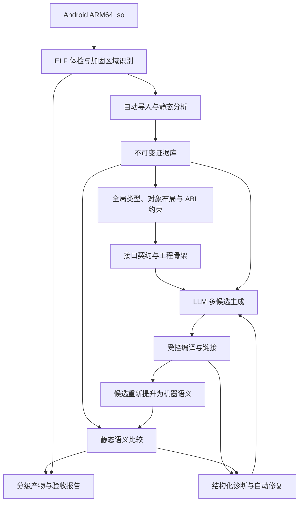
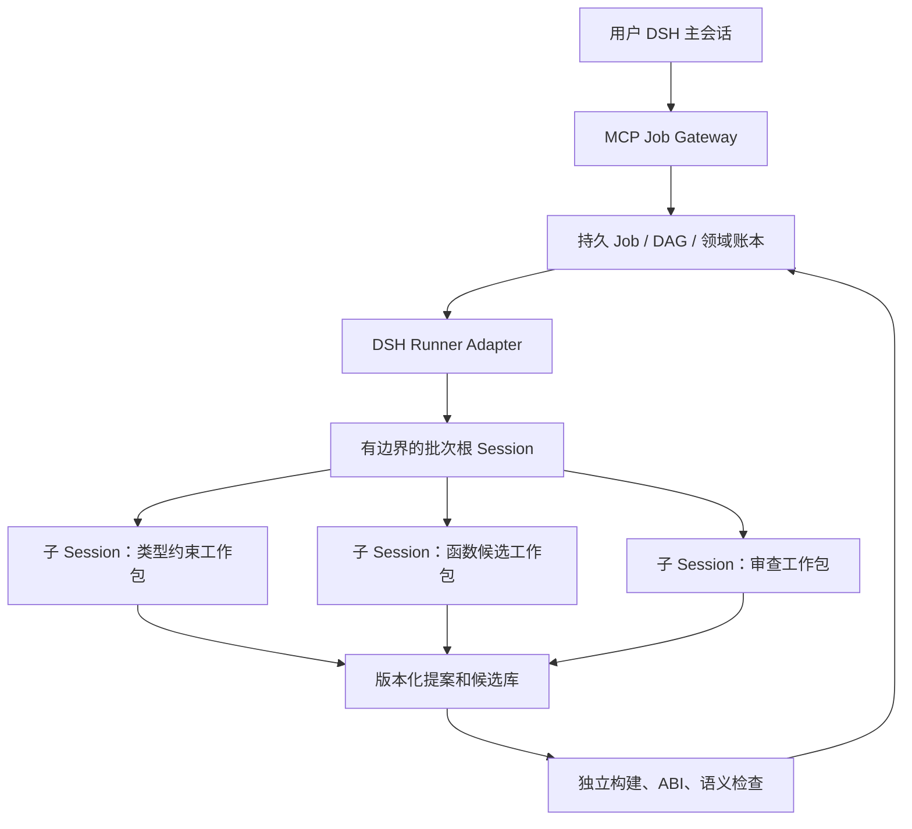

# Android ARM64 `.so` 全自动 C++ 源码重建方案

> 文档状态：讨论初稿，尚未定稿为 V1。
>
> 版本：0.2-draft（保留基础方案，增补主会话／子会话与 DSH 设计）。
>
> 调研日期：2026-10-12；用户确认目标仅为 Android `arm64-v8a`。
>
> 本文件先保留上一轮完整设计；后续需求通过增补章节进入工作稿。确定方向后，再统一优化全文并发布 V1。
>
> DSH 已由用户确认：DeepSeek 官方 DeepSeek Harness。第 47–66 节是本轮增补；如与基础章节的简化描述有差异，以增补中的明确约束为准，V1 时统一整合。

## 设计结论

建议以 **Dryxio/reagent 为二创基础，补建 Android ARM64 专用的静态分析、C++ 类型恢复、工程生成和语义验证层**。核心产品定义为：

> 输入 Android `arm64-v8a` `.so`，自动生成带证据追踪的 C++ 重建工程，通过编译、ABI 检查和静态语义验证筛选结果，并自动报告无法恢复或无法证明的部分。

可以追求高质量的语义重建，但不能保证从任意 `.so` 找回原始 C++ 源码，或证明所有函数的完整语义等价。编译会删除名称、模板来源、宏、注释和部分程序结构；优化还会合并、内联或删除代码。增加 Token 能改善候选搜索与推理，无法补回已经丢失的信息。

本稿包含调研、架构、落地和验收四部分基础内容，以及主／子会话、多 Agent 执行和 DSH 兼容增补。性能门槛属于建议的研发验收目标，尚未经过真实 Android `.so` 恢复实验验证。

## 文档一：技术调研与参考项目评估

### 1. 已确认的需求范围

| 项目 | 本次设计约束 |
|---|---|
| 目标平台 | 仅 Android |
| 目标架构 | 仅 `arm64-v8a` / AArch64 |
| 输入形式 | ELF64 共享库 `.so` |
| 输出语言 | C++，允许声明过的 NDK 编译器扩展和 ARM Intrinsics |
| 工作方式 | 每个任务全自动，无需人工选择函数、修复类型或修改工程 |
| 分析方式 | 纯静态 |
| 加固范围 | 允许部分混淆；排除需要运行时解密或生成代码的区域 |
| 模型策略 | 质量优先，允许较大的 Token 消耗 |
| 项目策略 | 允许二创现有开源项目 |
| 质量判定 | 编译、ABI、语义和完整性分别报告 |
| 最终目标 | 可维护、可编译、尽可能保留原库行为的 C++ 工程 |

“纯静态”允许反汇编、反编译、编译和链接候选源码，以及符号语义分析、SMT 求解；禁止运行原始库、候选库、测试 Harness、模拟器或设备程序。`.init_array`、`JNI_OnLoad` 等入口只分析，不调用。

### 2. 两个参考仓库的核查结果

本次下载并检查了实际源码，固定到以下提交：

| 仓库 | 核查提交 | 代码中的版本 | 定位 |
|---|---|---|---|
| meyz664K/auto-re-agent | [`be6f77c`](https://github.com/meyz664K/auto-re-agent/tree/be6f77cb9ae1ad74011e27e05eea6b959dae132e) | `0.1.0` | 较早的 Reverser / Checker MVP |
| Dryxio/reagent | [`d12cea3`](https://github.com/Dryxio/reagent/tree/d12cea338c61898b06a86fe8adb25275fa9d5615) | `0.4.0` | 已扩展的证据、候选验证和任务管理框架 |
| Dryxio/ghidra-bridge | [`faaf053`](https://github.com/Dryxio/ghidra-bridge/tree/faaf05363796cbc43eac7924f3b6981cd5e40619) | 单独包 | Ghidra 数据导出与查询层 |

两个参考项目的包元数据、模块结构和作者信息存在明显延续关系。因此，它们更适合视为同一类方案的不同发展阶段，不能作为两个独立技术路线的效果对照。

#### 2.1 meyz664K/auto-re-agent

主要流程：

```text
选择函数
  → 从 Ghidra 获取上下文
  → Reverser 生成 C++
  → Checker 检查
  → 根据意见修复
  → 输出代码、Parity 报告和进度
```

修复循环在 LLM Checker 返回 `PASS` 后即可设置 `success=True`。后续 Parity 检查保留了原成功状态，没有把结构风险统一纳入最终成功判定。[修复循环源码](https://github.com/meyz664K/auto-re-agent/blob/be6f77cb9ae1ad74011e27e05eea6b959dae132e/src/re_agent/agents/loop.py#L101)、[单函数编排源码](https://github.com/meyz664K/auto-re-agent/blob/be6f77cb9ae1ad74011e27e05eea6b959dae132e/src/re_agent/orchestrator/single.py#L61)

- 适合学习双角色生成与修复循环。
- 支持函数级代码生成及基本进度管理。
- 成功状态偏向模型判断。
- 缺少从裸 `.so` 自动生成完整工程的链路。
- 缺少独立的机器语义验证层。

不建议以这个版本作为主要二创起点。

#### 2.2 Dryxio/reagent

主要流程：

```text
目标规划与依赖选择
  → 收集反编译、汇编、CFG、P-code 等证据
  → Reverser 生成或修复候选
  → Checker 审查
  → Objective Verifier 检查结构差异
  → 候选工程 Overlay
  → 配置的构建、测试及 Parity 门禁
  → 保存检查点、历史和覆盖率
```

| 可复用模块 | 现有价值 |
|---|---|
| Backend Protocol | 分析后端能力抽象 |
| Reverser / Checker | 角色隔离与修复反馈 |
| Evidence Investigation | 按需查询额外静态证据 |
| Target Plan | 有边界的函数与调用依赖清单 |
| Candidate Overlay | 隔离候选修改 |
| Session / Identity | 检查点、历史和过期结果识别 |
| Knowledge Graph | 函数、调用、字符串及全局量关系 |
| Reports / Coverage | 结果和检查过程可追踪 |
| LLM Provider | 多种模型接口适配 |

| 缺口 | 源码核查结论 | 二创要求 |
|---|---|---|
| 裸二进制启动 | 仍需准备 Ghidra 项目及配置 | 自动创建项目、导入、分析、导出 |
| 工程初始化 | Overlay 主要面向已有项目或单个候选文件 | 从零生成头文件、源文件、构建和导出配置 |
| 全局类型恢复 | 依赖已有类型、符号及源码上下文 | 新建跨函数类型与布局约束求解器 |
| 语义验证 | Objective 主要比较调用、分支和部分常量 | 新建机器语义比较层 |
| Android 专项 | 通用 C++ Profile 不能覆盖完整 Android ABI | 新建 Android ARM64 Profile |
| 完整性 | Manifest 覆盖率针对选定清单 | 增加全库、字节区域及入口闭包覆盖率 |
| 静态限制 | 支持执行测试、Runtime 和差分 Harness | 本方案禁用这些路径 |

`verification/objective.py` 的 `PASS` 表示没有发现所检查的结构差异，不能解释为语义等价。修复循环允许 Objective 的 `UNKNOWN` 不直接阻断候选成功。[Objective Verifier](https://github.com/Dryxio/reagent/blob/d12cea338c61898b06a86fe8adb25275fa9d5615/src/re_agent/verification/objective.py)、[修复循环](https://github.com/Dryxio/reagent/blob/d12cea338c61898b06a86fe8adb25275fa9d5615/src/re_agent/agents/loop.py#L165)

现有差分验证会执行参考与候选 Harness，不能作为本方案的验收路径。[差分验证源码](https://github.com/Dryxio/reagent/blob/d12cea338c61898b06a86fe8adb25275fa9d5615/src/re_agent/verification/differential.py)

结论：复用 Dryxio/reagent 的编排基础，重建其质量判定和 Android 二进制到完整工程的核心链路。

#### 2.3 ghidra-bridge 的关键限制

1. 导出器打开已有 Ghidra Program，并设置 `analyze=False`，没有承担从输入 `.so` 自动导入和完成分析的职责。
2. Vtable 导出依赖符号名称及指针扫描，不足以覆盖无 RTTI、多继承、构造期虚表等完整 C++ 对象模型。
3. High P-code 操作数以字符串形式导出，缺少证明引擎所需的显式位宽、地址空间、内存语义和结构化操作数。

以上可在[导出器源码](https://github.com/Dryxio/ghidra-bridge/blob/faaf05363796cbc43eac7924f3b6981cd5e40619/ghidra_ai_bridge/exporters/runner.py)中核查。

reagent 当前按固定字符数裁剪证据，JSON 内容也会缩减列表、字段和深度。本项目应改成可分页、可追踪、带完整性标记的检索，禁止静默裁剪关键分支、调用目标或内存访问。[证据裁剪源码](https://github.com/Dryxio/reagent/blob/d12cea338c61898b06a86fe8adb25275fa9d5615/src/re_agent/utils/evidence.py)

#### 2.4 本次实际验证

| 项目 | 本地测试结果 |
|---|---|
| meyz664K/auto-re-agent | 63 通过 |
| Dryxio/reagent | 197 通过、2 跳过 |

测试使用 `not llm and not ghidra` 标记筛选。结果支持对仓库工程基础的判断，不代表已完成 Ghidra 集成、DeepSeek 调用或 Android `.so` 还原验证。

### 3. 补充项目、论文及社区实践

| 技术／项目 | 可借鉴部分 | 对本需求的限制 |
|---|---|---|
| [LLM4Decompile](https://github.com/albertan017/LLM4Decompile) | 汇编到源码、反编译精修、公开评测 | 主要支持 Linux x86-64 到 C，不能代表 Android C++ 效果 |
| [Decompile-Bench](https://arxiv.org/abs/2505.12668) | 二进制—源码配对、泄漏控制 | 需另建 Android ARM64、完整共享库和 C++ ABI 数据集 |
| [SK²Decompile](https://arxiv.org/html/2509.22114v1) | 先恢复结构，再恢复名称 | 数据主要来自 C 与 x86 Linux 配置 |
| [ReF Decompile](https://arxiv.org/abs/2502.12221) | 跳转重标记、调用信息补充类型 | 可用于输入规范化，不提供完整共享库重建 |
| [DeGPT](https://www.ndss-symposium.org/ndss-paper/degpt-optimizing-decompiler-output-with-llm/) | 多角色精修、可读性 | 模型审查不能替代语义验证 |
| [Agent4Decompile](https://arxiv.org/html/2604.23940v2) | 分层约束与修复反馈 | 正文范围 C／x86-64，行为门禁依赖执行 |
| [AutoDecompiler](https://arxiv.org/html/2606.16162v2) | 多轮反馈及避免修复退化 | 使用编译、执行和输入输出反馈，不能整体照搬 |
| [D-Helix](https://www.usenix.org/conference/usenixsecurity24/presentation/zou) | 重编译与符号模型差异检测 | Android ARM64、C++ 和环境模型需移植 |
| [rev.ng](https://docs.rev.ng/references/artifacts/) | 显式模型、可重编译 C 和工程产物 | Android ABI 和 C++ 质量需实测 |
| [TYGR](https://www.usenix.org/conference/usenixsecurity24/presentation/zhu-chang) | 数据流图推断基本及结构类型 | 推断结果作为候选，不作为确定事实 |

Agent4Decompile 的摘要页与所查 v2 PDF／正文的效果数字存在差异。本方案不采用摘要页上的高成功率作为预期；正文也排除了混淆及 x86-64 以外架构。[论文 PDF](https://arxiv.org/pdf/2604.23940v2)

社区游戏反编译实践说明长期编排、CI、进度与候选回滚的重要性，但包含人工协作，不能作为纯静态、无人干预的效果证明。[作者技术文章](https://momo5502.com/posts/2026-10-09-game-decompilation/)

### 4. 工具选型建议

| 层级 | 首选 | 补充／备选 | 原则 |
|---|---|---|---|
| ELF 解析 | LIEF | LLVM ELF 工具 | 两路核查关键结构 |
| 主分析 | Ghidra Headless | — | 自动导入、分析和结构化导出 |
| 指令核查 | Capstone／LLVM | — | 边界与解码差异 |
| 第二反编译器 | RetDec 或 rev.ng | 商业后端可选 | 发现分歧，不用多数票证明 |
| C++ 类型 | 自研约束求解 | Ghidra RTTI、研究型推断 | ABI 规则优先 |
| 编译 | Android NDK Clang | 固定历史 NDK | 固定 sysroot、运行库和配置 |
| 语义求解 | Z3 等 SMT Solver | 独立求解器复核 | 保留 UNKNOWN |
| 编排 | Dryxio/reagent | 持久任务层 | 改造成功语义 |

Ghidra HeadlessAnalyzer 不是线程安全的，分析任务采用进程隔离。[官方 API](https://ghidra.re/ghidra_docs/api/ghidra/app/util/headless/HeadlessAnalyzer.html)

不能直接把 angr 当成完备的 ARM64 验证后端；选定版本需核查 AAPCS64 大类型参数和 Solver 超时问题。[AAPCS64 议题](https://github.com/angr/angr/issues/7028)、[超时议题](https://github.com/angr/angr/issues/7226)

`Ghidra-Cpp-Class-Analyzer` 已归档，适合参考算法。优先评估 Ghidra 自身类恢复逻辑，再补 Android 专项。[归档项目](https://github.com/astrelsky/Ghidra-Cpp-Class-Analyzer)、[内置脚本](https://github.com/NationalSecurityAgency/ghidra/blob/master/Ghidra/Features/Decompiler/ghidra_scripts/RecoverClassesFromRTTIScript.java)

## 文档二：系统架构设计

### 5. 产品目标和结果等级

| 质量维度 | 回答的问题 |
|---|---|
| 源码完整性 | 已恢复哪些函数、数据、入口和依赖？ |
| 构建状态 | 模块或完整工程是否真实编译和链接？ |
| ABI 状态 | 导出、调用约定和对象布局是否通过静态检查？ |
| 语义状态 | 在什么输入域、边界及环境假设下验证了什么？ |

| 等级 | 产物含义 | 允许声明 |
|---|---|---|
| A0：分析完成 | 证据、清单和缺口报告 | 完成自动分析 |
| A1：部分源码 | 部分函数／模块及编译对象 | 部分源码可编译 |
| A2：完整构建候选 | 目标范围内完整工程及构建成功的 `.so` | 工程可构建，语义状态单独报告 |
| A3：范围内静态验证 | 指定入口闭包通过声明范围验证 | 在列明条件下通过静态语义验证 |

“完整”必须附带范围。未解析间接调用、缺失内部函数或未知区域不能被忽略。单函数通过不能升级为全库通过，有限边界验证不能升级为无界等价。

### 6. 总体架构



主状态由确定性编排器管理。LLM 提出恢复假设、候选和修复方案，不能修改验收状态。

### 7. 模块划分与职责

| 模块 | 输入 | 输出 | 职责 |
|---|---|---|---|
| Intake | `.so`、可选依赖 | 清单与指纹 | 格式、架构、区域及依赖初检 |
| Android ELF Loader | 文件结构 | 逻辑内存映射 | 重定位、符号、TLS、动态标签 |
| Analysis Worker | 逻辑映射 | 指令、函数、CFG、反编译 | Ghidra 及补充解码 |
| Evidence Store | 分析结果 | 版本化证据 | 原始事实、来源、完整性和分页 |
| Inventory Builder | 代码和数据证据 | 全库清单 | 入口、函数、数据及未知区域 |
| Type / ABI Solver | 数据流和规则 | 类型候选与接口契约 | 跨函数传播与布局约束 |
| Dependency Planner | 调用及类型图 | SCC 与调度顺序 | 循环依赖、失效与批次 |
| Project Generator | 接口与模块 | C++ 工程 | 头文件、源文件、导出和构建 |
| LLM Workers | 证据与契约 | 源码与假设 | 恢复、审查、命名和修复 |
| Build Gate | 候选工程 | 构建诊断 | 编译实际候选 |
| Semantic Verifier | 原始及候选语义 | 证明、反例或未知 | 位精确比较与范围 |
| Artifact / Report | 所有结果 | 分级代码和报告 | 覆盖率、缺口和台账 |

首版使用单机任务服务、数据库和文件对象存储。按实测并发与存储需要再拆分服务。

### 8. Android ELF 专项处理

- ELF64、`EM_AARCH64`、Little Endian、共享对象识别。
- Program Header 与 Section Header 交叉核查。
- `.dynsym`、`.symtab`、符号可见性与版本。
- `DT_NEEDED`、SONAME、GOT、PLT、导入符号。
- RELA、RELR、Android Packed Relocations。
- `.init_array`、`.fini_array`、TLS、异常和展开信息。
- `.rodata`、`.data.rel.ro`、可写全局量、BSS。
- `JNI_OnLoad`、静态 JNI 导出与动态注册表。
- BTI／PAC 特征和 ELF 属性。

Android 使用 ELF 和 Little Endian；C++ 名称修饰与 Generic／Itanium ABI 有关。[Android ABI](https://developer.android.com/ndk/guides/abis)

Packed Relocations 与 RELR 不正确会影响虚表、函数表和全局指针。[Bionic 文档](https://android.googlesource.com/platform/bionic/+/HEAD/android-changes-for-ndk-developers.md)、[LIEF 接口](https://lief.re/doc/latest/doxygen/ELF_2Relocation_8hpp_source.html)

仅凭 ELF 不能可靠确定全部原始 API、NDK 和编译参数。报告记录观察线索、最低 API 推断下界、实际重建配置及不确定配置，不把成功链接配置称为原始配置。

### 9. 函数和代码区域发现

多来源：符号、展开信息、直接调用／尾调用、虚表／回调表、JNI 注册、初始化／析构入口、经验证指令扫描及第二后端。

可执行区域状态：

```text
已解码代码
函数边界待确认
代码／数据归属不确定
工具不支持的指令
疑似加密或运行时生成区域
```

未知样本报告已发现清单覆盖率；验收样本使用隔离真值计算实际召回。

### 10. 证据层：两种 IR

| 表示 | 用途 | 限制 |
|---|---|---|
| 原始指令及 Raw P-code | 机器语义、位宽、内存访问 | 依赖解码器与 Lifter |
| High P-code、反编译 C、CFG | 类型、结构、LLM 上下文 | 可能受类型猜测及优化影响 |

不以反编译文本单独代表原始语义。保留有符号／无符号、移位、内存及浮点区别。[P-code 参考](https://ghidra.re/ghidra_docs/languages/html/pcoderef.html)

IR 操作包含原始地址及字节、操作码、输入输出位宽、地址空间、结构化操作数、基本块、控制流、异常／终止属性、工具版本。原始证据不可改写，假设另存并引用证据 ID。

### 11. 全局类型恢复

采用约束求解与候选推断，证据优先级：

```text
有效 DWARF 与明确 ABI 元数据
  > 动态符号及可确认导入声明
  > RTTI、重定位和布局证据
  > 跨函数数据流
  > 编译器／运行库模式
  > LLM 或学习模型推断
```

约束来自访存宽度／偏移、有符号性、参数返回流、分配与构造写入、虚调用对象调整、外部接口、常量及字符串。冲突保留多个候选，检查全部相关约束；无法收敛时保留低层表示与不确定性。

### 12. C++ 类与对象布局恢复

| 能力 | 证据 |
|---|---|
| 类名与继承 | RTTI、修饰符号 |
| Vptr 与虚表地址点 | 重定位、对象写入、虚调用 |
| 多继承 | 子对象、this 调整、Secondary Vtable |
| 虚继承 | 虚基偏移、VTT、构造期虚表 |
| 构造／析构变体 | 符号、调用、Vptr 写入、释放 |
| 字段布局 | 偏移、宽度、生命周期 |
| 成员函数指针 | AArch64 C++ ABI |
| 静态局部对象 | Guard Variable、初始化调用 |

同时参考 [Generic C++ ABI](https://itanium-cxx-abi.github.io/cxx-abi/abi.html) 与 [AArch64 补充](https://github.com/ARM-software/abi-aa/blob/main/cppabi64/cppabi64.rst)。无法确认的类可以显式布局表达，改写自然继承结构需再验证。

### 13. AAPCS64 调用约定

覆盖参数寄存器和栈参数、浮点／SIMD、HFA／HVA、小型聚合、间接返回与 x8、可变参数、栈对齐、寄存器保存、非平凡 C++ 类型、this 调整、Thunk、尾调用、Android 平台寄存器约束。不能根据寄存器数量直接猜参数。[AAPCS64](https://github.com/ARM-software/abi-aa/blob/main/aapcs64/aapcs64.rst)

### 14. JNI 恢复

识别 Java_*、JNI_OnLoad、JavaVM／JNIEnv；恢复可静态确定的 JNINativeMethod 表；传播方法名、签名、函数指针和注册类；将注册目标纳入入口。保留 VM 外部环境假设。

不能假设全部 Native 都有 JNIEnv 参数，CriticalNative 需区分；仅 `.so` 可能缺少 DEX 注解与类上下文。[JNI 文档](https://developer.android.com/ndk/guides/jni-tips)

动态拼接且不可求值的注册信息产生缺口，不伪造。

### 15. 部分混淆处理

| 类型 | 策略 |
|---|---|
| 常量混淆 | 位向量化简与常量传播 |
| 不透明谓词 | 条件和可达性求解 |
| 平坦化 | 状态变量、Dispatcher、转移关系 |
| 冗余分支／死块 | 证明不可达后删除 |
| 间接跳转 | 值域、表项、重定位和数据流 |
| 静态可解字符串变换 | 分析语义并保留证据 |
| 运行时解密／生成代码 | 排除区域 |

保存转换前后 IR、规则、前提与验证结果。排除区域的影响传播到调用及数据依赖；独立区域继续处理，受影响入口不能最高等级通过。

### 16. 工程生成

```text
recovered/
├── CMakeLists.txt
├── CMakePresets.json
├── toolchain-lock.json
├── include/
│   ├── recovered_api.hpp
│   ├── recovered_types.hpp
│   └── recovered_layouts.hpp
├── src/
│   ├── module_*.cpp
│   ├── globals.cpp
│   ├── jni_bindings.cpp
│   └── initializers.cpp
├── abi/
│   ├── exports.map
│   └── abi-manifest.json
├── evidence/source-map.json
├── verification/
│   ├── contracts.json
│   ├── proof-ledger.json
│   └── counterexamples/
└── reports/
    ├── summary.md
    ├── coverage.json
    └── gaps.json
```

构建使用受控模板，LLM 不自由修改构建脚本或添加执行命令。固定 Android ABI、NDK、API、sysroot、运行库、构建参数；保留导出属性及 SONAME；实际实现初始化、全局数据及业务行为。禁止调用原 `.so`、复制 `.text`、保留跳板冒充恢复。

libc++ 静态／共享选择进入兼容性约束。[运行库文档](https://developer.android.com/ndk/guides/cpp-support)

页大小与 ELF 对齐进入检查；静态判断不替代设备运行验证。[16 KB 页文档](https://developer.android.com/guide/practices/page-sizes)

### 17. LLM 角色与质量优先策略

| 角色 | 职责 |
|---|---|
| Recovery | 根据机器证据恢复实现 |
| Type / ABI Analyst | 类型和调用契约候选 |
| Reviewer | 从完整证据寻找遗漏 |
| Repair | 根据错误、冲突、反例修复 |
| Naming / Organization | 行为稳定后改善命名和组织 |

角色隔离不构成独立正确性证据。复杂函数多候选，歧义类型／ABI 多假设，大函数完整分页与切片，按真实诊断增加检索和修复，依赖变化重新验证，命名后置。

允许长上下文但必须标记未读取证据。仍需有限终止；相同候选与诊断持续重复或缺少可获得证据时，停止并报告。

### 18. DeepSeek V4.1 Flash 适配

官方使用 `deepseek-flash`，提供 OpenAI 兼容接口，规格列出 1M 上下文和最大 384K 输出。[调用文档](https://api-docs.deepseek.com/)、[模型规格](https://api-docs.deepseek.com/quick_start/pricing/)

新增 Thinking、必要协议字段、完整消息与工具历史、finish_reason、流式完整性、JSON 与本地 Schema 校验、指纹／用量／错误／重试。JSON 格式不代表本地契约合格；length 可能截断。[API 文档](https://api-docs.deepseek.com/api/create-chat-completion/)

别名可更新，重放依赖保存的候选和验证产物，不保证再次调用相同源码。

### 19. 自动修复闭环

```text
固定原始证据与接口约束
  → 按 SCC 规划
  → 多候选
  → AST 与类型检查
  → 真实编译
  → ABI、布局、依赖检查
  → 候选机器语义提升
  → 静态比较
  → 诊断修复或补证据
  → 候选事务提交或降级
```

SCC 处理递归、互调、共享类型。公共类型变化使相关候选、构建、证明失效。隔离修改；未通过不覆盖较好候选；先语义／ABI、再覆盖率／可读性；优化退化自动回滚。

### 20. 静态语义验证

比较原 ARM64 机器码与重新编译候选 ARM64 机器码的显式语义，针对实际构建结果。

精确建模确定性子集的差异公式：

```text
前提 A(输入, 初始状态)
AND
原始行为与候选行为存在差异
```

比较返回位模式、可观察访存、全局量／TLS、外部调用和参数、异常／终止／陷阱以及可建模循环行为。地址按逻辑区域映射，绝对地址、代码字节及特定布局数值依赖需专项处理。

| 结果 | 解释 |
|---|---|
| 精确反例 | 声明范围内存在差异 |
| 完整模型下不可满足 | 列明前提与模型下等价 |
| 有限展开不可满足 | 给定边界内未发现差异 |
| 超时、模型不完整、指令不支持 | UNKNOWN |
| 外部契约尚未证明 | 条件化结论 |
| 前提不可满足 | 禁止空域证明 |

[D-Helix](https://www.usenix.org/conference/usenixsecurity24/presentation/zou) 提供方法参考，ARM64／Android／C++ 专项仍需研发。解码器、Lifter、编译器、内存模型和 Solver 为可信基础，记录版本和能力。

### 21. 外部环境与难点

| 难点 | 原则 |
|---|---|
| libc／libm／libc++ | 版本化契约、列明依赖 |
| JNI／Java 对象 | 保留 VM 外部状态 |
| 未提供业务库 | 可恢复接口，无法证明内部 |
| 未解析函数指针 | 阻断严格入口闭包验证 |
| 并发／原子 | 保留顺序和屏障，缺模型则未知 |
| NaN、FMA、舍入 | 位精确，禁止随意 fast-math |
| 异常／RAII | Landing Pad、清理、析构 |
| 自校验／代码字节 | 专项标记 |
| SVE／SME | 按支持情况判定 |

禁止外部调用随意常量返回、删除异常路径、原子改普通访存来获取编译成功。

### 22. 数据契约

| 记录 | 必需字段 |
|---|---|
| Evidence | 指纹、范围、字节、IR、CFG、调用、引用、来源、完整性、缺口 |
| Contract | 参数返回、类型候选、内存、外部依赖、前提、版本 |
| Result | 候选指纹、源码映射、构建、ABI、语义、边界、假设、缺口 |

```json
{
  "semantic": {
    "status": "BOUNDED_EQUIVALENT",
    "input_contract": "contract-17",
    "loop_bound": 64,
    "recursion_bound": 0,
    "external_assumptions": ["external-contract-8"],
    "unsupported_operations": [],
    "solver_result": "unsat",
    "whole_program_equivalence": false
  }
}
```

该示例只表示记录契约与边界内通过。

### 23. 源码质量要求

- 类型、字段、接口有证据。
- 不确认名称标为恢复命名。
- 业务逻辑实际 C++ 实现。
- 保留必要位操作和内存语义。
- 不强行还原原始模板或类结构。
- 内联／合并／拆分保留多对多映射。
- 恢复声明回溯证据和验证。

低层 C++ 可作为保真产物，高层提升重新验收。

## 文档三：落地实施与运行方案

### 24. 二创改造范围

| 分类 | 能力 | 处理 |
|---|---|---|
| 复用 | Backend、Session、Reports、LLM Registry | 升级数据契约 |
| 改造 | Reverser／Checker | 多候选、反馈、事务 |
| 改造 | Target Plan | 全库清单和入口闭包 |
| 改造 | Knowledge Graph | 类型、布局、契约、证明依赖 |
| 改造 | Overlay | 无原工程项目生成 |
| 改造 | Identity | 原始二进制、工具链、模型、契约 |
| 改造 | Bridge | 自动导入、Raw IR、完整导出 |
| 新增 | Android ELF／JNI | 专用解析 |
| 新增 | Type／ABI Solver | 全局约束 |
| 新增 | Semantic Verifier | 机器语义比较 |
| 新增 | Artifact Grader | 分级和完整性 |
| 禁用 | Runtime／执行差分 | 不进入任务路径 |

基础仓库 MIT 许可，保留声明；其他依赖形成固定版本 SBOM。[reagent](https://github.com/Dryxio/reagent)、[bridge](https://github.com/Dryxio/ghidra-bridge)

### 25. 分阶段实施

按 5–7 人有经验团队估算，非已验证工期。

| 阶段 | 周期 | 交付 | 退出条件 |
|---|---|---|---|
| M0 | 2–4 周 | 样本、导入、Raw IR、最小比较 | 基本 ABI／内存无错误通过 |
| M1 | 4–6 周 | 端到端候选与报告 | 无人修改，真实候选编译 |
| M2 | 4–6 周 | 类型、布局、JNI、工程 | 核心 ABI 通过，缺口传播 |
| M3 | 6–8 周 | 多候选、反例修复、证明台账 | 负向变异阻断错误 |
| M4 | 4–6 周 | 恢复、回滚、批量、验收 | 固定验收门槛 |

可部分重叠，约 4–6 个月受限 MVP；复杂覆盖长期研发。M0 优先验证语义层，不能靠更多 Token 代替可靠区分基本错误。

### 26. 人员分工

| 方向 | 工作 |
|---|---|
| ARM64／二进制 | 指令、边界、ELF、Ghidra、IR |
| C++／Android ABI | 类、调用、JNI、异常、运行库 |
| 形式化 | 内存、SMT、循环、契约 |
| LLM／后端 | Provider、候选、检索、修复、调度 |
| 基础设施／质量 | 沙箱、构建、样本、恢复、验收 |

可兼任，形式化与 ABI 需专业能力。

### 27. 部署建议

任务 API、持久队列、PostgreSQL 或 SQLite、对象存储、Ghidra 进程、NDK 进程、SMT 进程、托管模型。

| 资源 | 起点 |
|---|---|
| CPU | 32 核级别 |
| 内存 | 128 GB |
| 存储 | 1–2 TB NVMe |
| GPU | 托管模型不必配置 |
| 分析并发 | 少量进程，实测调整 |
| Solver 并发 | 独立限额 |
| LLM 并发 | 配额、延迟、错误率自适应 |

按函数复杂度、间接调用、类型冲突及证明难度估算工作量，不只看文件大小。

### 28. 全自动接口

拟开发接口，非现有 reagent 命令：

```bash
arm64-recover analyze \
  --binary ./libtarget.so \
  --policy ./android-arm64-static.yaml \
  --output ./recovered
```

| 接口 | 用途 |
|---|---|
| POST /jobs | 提交 |
| GET /jobs/{id} | 状态 |
| GET /jobs/{id}/events | 进度 |
| GET /jobs/{id}/artifacts | 产物 |
| POST /jobs/{id}/cancel | 取消、检查点 |

终态：COMPLETED_VERIFIED、COMPLETED_BUILDABLE、COMPLETED_PARTIAL、BLOCKED_BY_INPUT、FAILED_INFRASTRUCTURE。质量不足与设施失败分开。

### 29. 策略配置

```yaml
target:
  platform: android
  abi: arm64-v8a
analysis:
  static_only: true
  inventory_scope: whole_library
  allow_partial_obfuscation: true
  runtime_generated_code: exclude
generation:
  quality_first: true
  initial_candidates: 4
  max_repair_rounds: 8
  preserve_best_candidate: true
  require_complete_evidence_marker: true
validation:
  compile_actual_candidate: true
  abi_check: true
  semantic_check: true
  unknown_is_equivalent: false
  bounded_is_unbounded: false
  prohibit_original_binary_forwarding: true
execution:
  target_execution: false
  candidate_execution: false
  emulator_execution: false
```

候选数和轮次为初始参数，可按复杂度扩展；扩展结束仍自动终止和记录原因。

### 30. 纯静态工程约束

输入和候选目录禁止执行；执行代理固定工具和参数；LLM 禁止任意 Shell；模板无 try_run／设备／测试执行；禁止目标动态加载；工具轨迹审计；隔离目录；二进制文本仅作为数据。允许执行分析工具、编译器、求解器。

### 31. 故障恢复与失效

| 情况 | 自动动作 |
|---|---|
| 模型限流／短超时 | 有界重试退避 |
| 输出截断 | 拒绝并完整重请求 |
| Ghidra 超时 | 保存已完成区域，记缺口 |
| Solver 超时 | UNKNOWN |
| 无进展 | 最佳候选保留，降级 |
| 类型变化 | 依赖闭包失效 |
| 工具链／契约变化 | 重跑相关门禁 |
| 中断 | 有效检查点恢复 |

指纹覆盖原二进制、依赖、分析及处理器语义版本、NDK／sysroot／运行库、构建参数、类型／契约、Prompt／Schema、模型配置和服务指纹、源码／产物、验证器／Solver。

### 32. Token 和成本

预算用于完成任务、解释用量和停止故障循环，不省略必要证据。

```text
输入 ≈ 函数数 × 有效调用数 × 平均输入
输出 ≈ 函数数 × 有效调用数 × 平均输出
```

例：10,000 函数、每函数 16 调用、每调用 40,000 输入与 10,000 输出，约 6.4B 输入、1.6B 输出。按调研日官方高峰缓存未命中价格，单模型算术示例约 3,840 美元；不代表项目报价，未含全局任务、额外重试、第二模型与本地计算。[定价](https://api-docs.deepseek.com/quick_start/pricing/)

监控每接受函数／每验证字节 Token、有效修复率、重复诊断率、补证据质量收益。

### 33. 运行产物

源码工程、成功模块或对应等级 `.so`、恢复架构、源码映射、ABI 报告、证明台账、反例包、函数／字节／入口覆盖率、缺口、运行审计。部分源码为合法终态但不算完整重建。

## 文档四：验收规范

### 34. 三层验收

| 层次 | 内容 |
|---|---|
| 系统 | 自动、静态约束、恢复、报告 |
| 构建能力 | 固定 Android 样本实际工程 |
| 语义能力 | 正确接受等价、拒绝差异、保留未知 |

系统通过不意味着每样本恢复成功，构建不替代语义。

### 35. 数据集

自建微型 `.so`、真实 C++ 库、困难／排除样本。真实候选：fmt、pugixml、jsoncpp、spdlog、yaml-cpp、tinyxml2、FlatBuffers、protobuf-lite；固定 SHA 与 Android 成功配置后入库。

基础矩阵：8 项目 × O0／O2／Os × 保留／Strip × 两套 NDK = 96 库。LTO、无 RTTI、异常、运行库、混淆、JNI、扩展专项补充。

### 36. 防失真

恢复器仅访问规定输入，源码／调试真值供独立验收器；按项目与相似簇分割；优化变体不跨泄漏边界；增补非公开样本；分别报告仅 so 和额外上下文；未知与未恢复保留在分母。公开库训练污染风险记录。

### 37. 必测特性

| 类别 | 测试点 |
|---|---|
| 整数 | 位宽、有符号、扩展、溢出、移位 |
| 浮点 | NaN、负零、FMA、转换、比较 |
| 调用 | 栈参、HFA／HVA、聚合返回、x8 |
| 内存 | 别名、对齐、数组、字段、全局 |
| C++ | 虚调用、继承、构造析构、成员指针 |
| 异常 | Throw、Catch、清理、重抛 |
| 生命周期 | Guard、初始化、退出 |
| ELF | Packed、RELR、TLS、隐藏符号 |
| JNI | 静态、动态注册、JNIEnv／JavaVM |
| 并发 | 原子、屏障、LL／SC、LSE |
| 混淆 | 平坦化、不透明、常量、间接跳转 |
| 扩展 | PAC／BTI、NEON、未知降级 |

未支持能力必须诚实未知并阻断严格通过。

### 38. 覆盖指标

函数发现召回／精确、源码恢复、实际编译、全工程构建、无界／有限／条件验证、字节覆盖、入口闭包、未知、错误接受率。不得仅用简单函数数量掩盖关键入口失败。

### 39. 工程硬门槛

无人干预、零目标／候选执行、真实候选构建、UNKNOWN 不升级、有限不升级无界、禁止空域证明、缺内部依赖不忽略、禁止 Stub／原库转发／复制 text、无静默证据丢弃、失效正确、检查点恢复、有限终止、汇总一致。

### 40. 首版能力门槛建议

M0 后冻结到具体样本：

| 能力 | 建议 |
|---|---|
| 核心微型工程 | 100% 构建 |
| 保留符号核心函数 | 100% 发现 |
| 固定 Strip 召回 | ≥95% |
| 核心 ABI 负向 | 零错误通过 |
| 无循环精确子集验证 | ≥90%，列明域 |
| 真实库工程构建 | ≥80% |
| 已知内部缺口 | 零静默忽略 |
| 非等价候选 | 零已证明等价误接受 |
| 困难／排除 | 100% 自动结束与原因 |

非任意 so 普适承诺，不套 C／x86 论文数字。

### 41. 负向变异

改变常量、分支、有符号、访存宽度、全局写入、this 调整、聚合返回、虚槽、析构、JNI、浮点、原子／屏障。仅保留明确非等价变异。首版至少 300 个，发布前扩展。错误可判差异或未知，不能判已证明等价。

### 42. 证明专项

区分 SAT／UNSAT／超时／中断；未知操作不当 NOP；未知调用不当无副作用；未知路径不当不可达；摘要进入台账；边界记录；前提可满足单查；完整与有限分开；指纹一致；地址映射不掩盖差异。关键结论可独立求解复核，不用 LLM 投票代替。

### 43. 构建与 ABI 验收

Android ABI、固定工具链、导出及版本、动态标签、调用契约、布局、虚表、JNI、初始化／析构、TLS、运行库、权限和对齐。允许外部依赖列明，缺业务依赖不虚构。静态通过不声称设备／App 运行验证。

### 44. 可读性与维护

可解析／索引／格式化；源码定位证据；已知类型布局有来源；命名可区分；模块无未声明依赖；无空实现；高层改写前后比较；组织改善不覆盖更好候选。LLM 可读性评价仅辅助。

### 45. 发布流程

```text
冻结配置与样本
  → 输入／真值隔离
  → 批量自动任务
  → 禁执行核查
  → 源码、构建、ABI
  → 证明、反例、未知
  → 负向变异
  → 中断／失效
  → 固定分母指标
  → 发布报告
```

报告支持／未支持能力、样本与版本、实测指标、误接受、失败类别、前提边界、允许产物等级。

### 46. 初版立项建议

核心投入：Android ARM64 完整证据与 ABI；无原工程的全局类型和 C++ 工程；保留未知、发现反例、追踪范围的静态验证。reagent 降低编排管理成本，LLM 扩大候选搜索并改善表达。质量由证据、ABI 与验证共同决定。

首版验收写为固定 Android ARM64 样本集的全自动、纯静态、分级重建，公布构建、验证与缺口；不签任意 so 原始 C++ 完整恢复保证。

## 初稿维护说明

- 本轮先落盘上述设计，保留讨论性质；还未统一优化为 V1。
- 已增补：多 Agent 执行粒度、并发、交接、共享状态、恢复及 DSH 兼容，见第 47–66 节。
- 定稿前统一检查：架构图、状态名、任务契约、配置样例、实施里程碑和验收标准之间的一致性。
- 本文件不是已实现系统的使用手册；拟开发接口均不能解释为已经可调用。

## 文档五：主会话—子会话与多 Agent 执行架构（本轮增补）

### 47. 调研结论与预选项目

深入调研见配套文件：[主会话—子会话与 DSH 调研](main-child-agent-DSH-RESEARCH.md)。该文件记录官方来源、DSH 固定源码、框架比较、已知限制及尚需验证事项。

| 层级 | 当前预选 | 采用范围 |
|---|---|---|
| 客户端 | DSH | 提交任务、查看状态、读取报告和产物 |
| Agent Runtime | DSH SDK 驱动的 Runtime + 本地 Fresh Spawn | 执行有边界工作包和多轮修复 |
| 持久编排 | 生产预选 Temporal | 全库 DAG、重试、恢复、取消与批次 |
| 领域状态 | Recovery 服务 + 数据库 + 对象库 | 类型、契约、任务、候选和验收 |
| 可选工作包内部图 | LangGraph | 有限局部 Agent 图，不另做全库调度 |
| 对照／备选 | AutoGen、CrewAI、OpenAI Agents SDK、OpenHands SDK | 模式或 Runner 比较，不同时引入 |

DSH 当前核查基线为 `0.2.1-alpha.2`、提交 `d743267388641bc76f17c45ce8b4c231aed1d32c`。本轮完成文档与源码核查，没有完成 DSH 安装和实际模型兼容测试。[固定快照](https://github.com/deepseek-ai/deepseek-harness/tree/d743267388641bc76f17c45ce8b4c231aed1d32c)

生产不采用“一个主 Agent 记住整库并完成所有阶段”，也不采用“每个阶段一个无限增长的 Agent”。所有大阶段拆成可调度工作包，主会话不成为全项目事实仓库。

### 48. 六种对象必须分开

| 对象 | 生命周期与用途 | 不代表什么 |
|---|---|---|
| Job | 一个输入库的恢复任务，持久存在 | 不是一个聊天会话 |
| Work Package | 有边界的任务、输入、依赖及输出 | 不是完整大阶段 |
| Attempt | 一个工作包的一次执行，绑定租约及版本 | 不是新的业务目标 |
| Session | 一个 Agent 的上下文与事件记录 | 不天然拥有任务完成权 |
| Activation | Session 的一次活动执行 | 结束不代表源码通过 |
| Candidate / Verification | 不可变源码候选和独立检查结果 | 不由聊天结论替代 |

一个 Job 包含多个 Work Package，每个包允许多个 Attempt。每个 Attempt 绑定一个执行 Session／Activation；更换会话不改变原工包身份。一个候选可以有多种构建和验证结果，均绑定明确版本。

任务依赖是 DAG，可以多前置依赖；原生会话归属是树，每个子 Session 有一个直接父 Session。两者分别存储，不能用会话树替代任务依赖图。

### 49. 逻辑组织与运行拓扑



用户主会话只提交、读取、解释和接受用户对目标的调整。后端调度器独立持有 Job；用户关闭客户端或结束一次聊天回合，不等于取消恢复任务。

根批次 Session 只承担调度器给出的有界批次。首版采用根 → 工作者的浅层原生树。模块协调是一种逻辑工包／持久任务分组，不强制额外创建长期等待的管理子 Agent。

可选层级扩展需通过容量试验后再启用。不能把所有子槽位分配给等待叶子任务的父 Agent。

### 50. Agent 角色、权限和交付物

| Agent | 工作包职责 | 允许输出 | 禁止直接操作 |
|---|---|---|---|
| Planning | 对一个有界分组提出拆分、优先级、补证据方案 | 可校验计划提案 | 全局任意创建任务、改验收规则 |
| Evidence Analyst | 处理一个区域或一个疑点 | 证据定位、边界／调用目标假设 | 改原始字节与证据 |
| Type / ABI Analyst | 一个类型组件／接口集合 | 字段、类型、ABI 约束提案 | 直接改公共头文件与契约版本 |
| Recovery | 一个函数、小组或一个区域候选 | C++ 实现、辅助声明、假设、证据引用 | 写接受分支、任意构建脚本 |
| Reviewer | 一个候选及其规定证据 | 问题、遗漏、待验证义务 | 提升 A 等级、修改候选 |
| Repair | 一组有界失败诊断 | 新候选及修改范围 | 忽略强差异、删除困难路径 |
| Integration Analyst | 一个模块或一批接口冲突 | 组合方案、冲突解释 | 无版本检查改共享源码 |
| Naming / Organization | 已稳定候选的限定范围 | 命名与组织候选 | 未经重验证替换实现 |
| Reporting | 一个模块或 Job 的验收记录 | 来源可追踪说明 | 自行宣称未通过部分成功 |

Agent 是有工具调用和多轮反馈的执行者，不只是一次补全文本。编译器、Lifter、Solver 等是 Tool Activity，不强行包装成判断真假的 LLM Agent。

Reviewer 不继承生成者的聊天过程，使用原始证据、契约和候选独立检查。模型一致意见只产生辅助证据，最终状态由第 20、39、42 节对应服务决定。

### 51. 每个大阶段的拆分规则

| 阶段 | 基本工作单位 | 可并行部分 | 需要有序的部分 |
|---|---|---|---|
| 二进制分析 | 代码范围、函数集合、数据区、表项组 | 解码、引用、区域证据 | 范围去重、函数边界确认 |
| 入口发现 | 一类入口或一个注册表 | 导出、初始化、JNI、回调查找 | 入口闭包更新 |
| 类型恢复 | 数据流／类型组件中的约束批次 | 各函数约束提取 | 合并、冲突求解、契约冻结 |
| 候选恢复 | 单函数、小型相关组、单候选方向 | 不同函数与不同候选 | 冻结接口下的集成 |
| 大函数恢复 | SESE 区域、循环、状态机区域 | 有明确边界的候选调查 | 效果合成和全函数验证 |
| 审查 | 一个候选／一个检查维度 | 多候选、多维度检查 | 强问题传播和候选选择 |
| 修复 | 一组关联失败、限定修改范围 | 不相关失败 | ABI／类型变更的依赖失效 |
| 工程集成 | 一个模块的候选集 | 独立模块构建 | 公共头文件、导出及最终链接 |
| 语义验证 | 单函数、闭合组件、入口闭包 | 独立证明义务 | 递归／依赖结论合成 |
| 报告 | 模块验收记录 | 各模块说明 | 按持久账本统一汇总 |

建议起步参数是每个普通恢复包 1 个复杂函数或少量简单相关函数，例如 1–8 个。数量不是唯一切分标准；实际按 IR 大小、CFG、类型冲突、依赖闭合及预估验证负载调整。

切分要求：

1. 有明确目标和停止条件。
2. 输入证据清单和版本冻结。
3. 输出范围和接口可校验。
4. 已声明调用、类型、数据及验收依赖。
5. 能单独失败、重试、替换执行者。

大型 SCC 不能简单按函数数切开后宣称独立。可以在暂定接口下并行提出候选，但递归假设和依赖证明闭合前保持条件化／未知。大函数分区必须记录入口、出口、读写及控制副作用，局部通过不自动等于全函数通过。

### 52. 工作包和提交数据

以下为拟开发业务数据示例，不是 DSH 原生配置：

```json
{
  "schema_version": 1,
  "job_id": "job-001",
  "task_id": "job-001/module-03/recover/fn-12/candidate-a",
  "role": "recovery",
  "scope": {
    "function_ids": ["fn-12"],
    "region_ids": []
  },
  "input_snapshot_id": "snapshot-7",
  "contract_revision": 12,
  "attempt": 1,
  "dependencies": ["job-001/types/component-3"],
  "evidence_manifest_ref": "evidence://job-001/fn-12/revision-7",
  "allowed_operations": ["evidence_read", "contract_read", "candidate_submit", "task_report"],
  "candidate_namespace": "candidate://job-001/task-12/attempt-1",
  "missing_evidence_policy": "report_gap",
  "limits": {
    "wall_timeout_seconds": 900,
    "max_tool_calls": 80,
    "max_agent_depth": 1
  }
}
```

租约令牌、鉴权材料和会话绑定由 Runner／工具代理管理，不进入上述模型任务文本。服务验证提交属于当前工作包、当前尝试和允许范围，不能信任模型自行填写的角色或权限。

返回数据至少包含：

```json
{
  "schema_version": 1,
  "job_id": "job-001",
  "task_id": "job-001/module-03/recover/fn-12/candidate-a",
  "attempt": 1,
  "input_snapshot_id": "snapshot-7",
  "contract_revision": 12,
  "disposition": "PROPOSED",
  "artifact_refs": ["candidate://job-001/task-12/attempt-1/source"],
  "evidence_refs": ["evidence://job-001/fn-12/revision-7"],
  "assumptions": [],
  "gaps": [],
  "requested_followup_tasks": []
}
```

`PROPOSED` 表示交付候选，不表示验收通过。`NEEDS_EVIDENCE`、`BLOCKED`、`NO_PROGRESS` 等触发调度决策；计划和后续任务请求也需验证。

Agent 不具有修改 `semantic.status`、A 等级或全库成功标志的接口。

### 53. 任务交接与会话轮换

每个工包交接包含：

| 信息 | 用途 |
|---|---|
| Job／Task／Attempt ID | 确认身份和责任 |
| 输入快照和依赖版本 | 防止旧上下文产生新提交 |
| 当前最佳候选和诊断引用 | 防止重新走失败路径 |
| 已检查／未检查证据项 | 防止误认调查完整 |
| 强差异、未知和假设 | 保留质量状态 |
| 下一步目标与提交条件 | 让新会话有界继续 |
| 停止条件 | 无进展时结束而不无限循环 |

首选 fresh 会话：角色指令 + 本工包完整必需证据或可分页引用 + 冻结契约 + 诊断。主会话历史只在确有必要时作为显式输入。

同一工包、同一版本、同一候选的短修复可续用 Session。输入／契约变化、角色变化、严重错误假设或上下文不足时，新建 Session；前会话保留供审计。

继承或摘要不能携带验收权限。旧会话的推断在新版本中必须重新检查。

### 54. 三层上下文和记忆

| 层 | 保存内容 | 更新者 |
|---|---|---|
| 会话上下文 | 当前工包证据、工具历史、候选和反馈 | 当前 Agent Runtime |
| 交接快照 | 可追踪摘要、产物引用、未解决问题 | Runner 记录，服务校验 |
| 项目事实库 | 原始证据、已接受契约、候选、证明、失效关系 | 领域服务 |

主会话只读小型项目状态视图；不接收所有子会话完整记录。完整子会话与原始证据仍保存并可按授权追踪。

上下文压缩与分页是组织信息，不是降低质量或删除证据。证明和闭包判断使用规范化原始产物，不使用自然语言摘要。跨工作包稳定知识通过版本化事实／约束传递，不能只通过群聊消息传递。

### 55. 持久调度、并发和背压

任务账本的建议状态：

```text
PLANNED → WAITING_DEPENDENCIES → READY → LEASED → RUNNING
  → RESULT_PROPOSED → CHECKING → ACCEPTED
  → RETRYABLE / NEEDS_EVIDENCE / BLOCKED / FAILED / CANCELLED
  → SUPERSEDED（输入或契约发生变化）
```

状态需要实现为合法转移表；箭头表示流程分支，不允许任意跳过检查。

分开限制 Agent 激活、模型请求、Ghidra、编译、Solver 和 Job 数量。模型不占用 Ghidra／Solver 的专用资源名额，等待资源的任务回到持久队列。

首版每个 DSH Runtime 批次可配置最多 6 个普通工作子会话，在已配置的 8 个子容量中留出审查／恢复余量；这些数值是调优起点，不是保证。批次开始前按实际容量核对，满时入后端队列，不反复调用创建。

子工作 Agent 默认没有再委托工具，原生深度先限制为 1。管理 Agent 不持有所有叶子所需名额后等待。后续分层必须预留叶子容量，并独立验证嵌套资源不会死锁。[DSH 容量说明](https://github.com/deepseek-ai/deepseek-harness/blob/d743267388641bc76f17c45ce8b4c231aed1d32c/packages/subagent/subagent/README.md)

调度策略：优先解除高影响类型／ABI 阻塞、保持不同复杂度任务公平、将 Solver 重负载单独排队。优先级由服务按策略生成，Agent 只能提出修改建议。

### 56. 共享类型、源码和候选事务

不能让所有 Agent 编辑同一 `recovered_types.hpp` 或共享源文件。

采用：

- 每个 Attempt 独立候选命名空间和隔离目录。
- 类型 Agent 提交约束，Type Solver 合并并冻结契约。
- Recovery Agent 在冻结契约下提交实现。
- 集成服务按候选清单物化模块和公共声明。
- ABI／类型变更通过版本检查提交，影响关系使相关结果失效。
- 最终接受分支仅由提交服务更新。

写操作校验 lease／fencing epoch、输入指纹、契约版本、允许文件范围及候选基线。旧执行者即使迟到，不能覆盖新状态。

Agent 对同一类型给出冲突判断时，服务创建一个有界冲突解析包；仍不能解决则记录低层表示或未知，不由多数票决定原始布局。

### 57. 工作包闭环与独立验收

```text
发放工包及输入版本
  → 子 Agent 调查和提交
  → 服务校验结构、归属和完整性
  → 工具生成实际候选工程
  → 编译／ABI／语义检查
  → 生成诊断／反例或未知
  → 修复包／补证据包／新类型轮次
  → 当前版本通过则提交，否则自动降级或结束
```

同一函数可以有多个独立候选尝试并行；互相不能覆盖。审查者读取必要原始证据，不把生成者的自我解释当作事实。

无进展判断使用候选指纹、诊断、约束和新增证据，不仅看聊天长度。已完成的一批工包不代表该阶段完成；阶段与 Job 完成由覆盖清单、依赖闭合及规则聚合决定。

### 58. DSH Runner 的实际集成设计

推荐由后端宿主通过 DSH SDK 启动一个固定 Profile 的 Runtime，在其中使用本地 Spawn。它与 `dsh-subagent-dsh-sdk` 外部子后端不同，后者目前不支持父级结构化输出和工具过滤。[本地 Spawn](https://github.com/deepseek-ai/deepseek-harness/blob/d743267388641bc76f17c45ce8b4c231aed1d32c/packages/subagent/subagent-spawn-in-process/src/index.ts)、[外部 SDK Provider](https://github.com/deepseek-ai/deepseek-harness/blob/d743267388641bc76f17c45ce8b4c231aed1d32c/packages/subagent/subagent-dsh-sdk/src/index.ts)

Runner 流程：

1. 持久调度器选择 ready 工作包和冻结的批次清单。
2. 为该批次创建独立根 Session，单 Session 不并发接受无关提示。
3. 根调用受控批次工具；插件使用当前活动 parent Agent 创建本地子 Activation。
4. 为每个子执行传入角色、任务、结构化要求和已验证工具允许表。
5. 子通过任务专用代理读取证据、提交不可变候选和结构化提案。
6. 结果逐项写账本，随后独立验收；根仅收批次摘要。
7. 批次结束释放 Activation／进程资源，后续批次可新建根 Session。

DSH Session、Activation、任务 ID 与 Attempt 关系存外部映射表。用户主会话不必长期保持活动，也不充当内部 Runtime 的 parent Agent。

程序側可使用 `startActivation(..., delivery: 'caller')` 收集结果，避免大量完成消息塞回主模型；只依赖核查版本确有的能力。受控插件不得把最终文本当成已通过验收。[Subagent API](https://github.com/deepseek-ai/deepseek-harness/blob/d743267388641bc76f17c45ce8b4c231aed1d32c/docs/subsystems/subagent.md)

子会话结构化返回异常、缺失或截断时，结果保持未提交／待检查。对于外部 SDK Provider，若以后采用，改用任务提交工具和专用 Profile 完成业务验证，不能传入不支持的 outputSchema／toolFilter。

## 文档六：DSH 客户端兼容、交付与验收（本轮增补）

### 59. 兼容分层与范围

| 层级 | 用户得到什么 | 当前设计状态 |
|---|---|---|
| C1：MCP 客户端兼容 | DSH 中提交、查询、取消、读报告与产物 | 首版必需 |
| C2：DSH Agent 执行 | 后端实际运行有边界 DSH 子会话 | 首版预选实现 |
| C3：原生界面增强 | Job 卡片、远程工作者树、点击查看执行记录 | 后续增强 |

C1 和 C2 不意味着所有后端子会话自动出现在用户客户端原生 `list_agents` 中。后端 Runtime 与客户端是不同会话范围，外部执行也有枚举限制；统一展示使用 Job 的 `list_workers` 和授权记录读取。

C3 若实施，明确标记远程 Job Worker，不能伪造 DSH 本地 Session 身份或修改官方持久日志格式。

### 60. MCP 工具接口

以下 raw tool 名称是拟开发接口。配置 serverName 为 `arm64_recovery` 时，DSH 展示相应 `mcp__arm64_recovery__<tool>` 名称。[官方 MCP](https://github.com/deepseek-ai/deepseek-harness/blob/d743267388641bc76f17c45ce8b4c231aed1d32c/packages/mcp/mcp-client/README.md)

| 工具 | 职责 | 调用时间原则 |
|---|---|---|
| describe_capabilities | 协议、版本、支持目标、连接检查 | 短调用 |
| submit_job | 输入引用、已配置策略、幂等键 → Job ID | 入队即返回 |
| get_job | 状态和当前质量视图 | 短调用 |
| get_events | 以 cursor 分页读增量进度 | 短调用 |
| list_workers | 本 Job 的任务、角色、Attempt 和 Session 关联 | 分页 |
| list_artifacts | 可下载／可读取产物清单 | 分页 |
| read_artifact | 授权范围内文本片段或产物引用 | 分页、明确截取范围 |
| cancel_job | 发出幂等取消请求 | 请求确认，清理状态另查询 |

原始库通过预配置工作区、挂载或输入登记服务进入后端，工具参数传 input_ref。远程部署不能把客户端文件路径直接当作服务器文件路径；安装时定义 staging 和引用映射。

不依赖 DSH 当前未实现的 MCP Task-required 扩展；普通短工具调用即可控制长任务。重连后使用相同 Job ID／cursor，重复提交用幂等键返回原任务。

### 61. DSH 配置与插件交付

下例是依据已核查 DSH MCP 字段设计的配置片段。`arm64-recover mcp` 为拟开发命令，尚未存在；此例不等于已经完成安装或联调。

```yaml
- id: arm64-recovery-mcp
  name: '@deepseek-ai/dsh-mcp-client'
  config:
    serverName: arm64_recovery
    transport: stdio
    command: arm64-recover
    args: ['mcp', '--transport', 'stdio']
    toolCallTimeoutMs: 60000
    failOnStartupError: true
```

远程服务使用官方 `streamable-http` transport，显式配置 endpoint 与认证。stdio 的 initialize／工具发现不得创建 Job；stdout 只输出协议，日志写 stderr。

`failOnStartupError` 表示插件激活失败，不能单独保证整个 DSH 应用退出；若该插件在客户端被配置为可选，应用仍可能启动。任务前需校验工具确已注册并完成 `describe_capabilities`，缺少连接时明确报告，不假装任务已提交。

产品安装包计划包含：

```text
integrations/dsh/
├── README.md
├── compatibility-lock.json
├── mcp-client.example.cordis.yml
├── worker-profile/
├── runner-adapter/
├── skills/android-arm64-recover/SKILL.md
└── acceptance/
```

Skill 负责解释用户操作和工具结果，不能替代后端调度及质量规则。新能力通过正式插件扩展点接入，不修改 DSH 核心循环；发布时固定已测试的 Runtime、SDK、Profile 和 Schema 版本。

Model Key 由对应 Runtime／服务的凭据配置管理，不经工包传递。MCP 子进程不能假设继承客户端全部环境；DSH 当前会清理部分环境变量，必要变量由安装配置显式提供。[MCP 环境说明](https://github.com/deepseek-ai/deepseek-harness/blob/d743267388641bc76f17c45ce8b4c231aed1d32c/packages/mcp/mcp-client/README.md)

### 62. 持久恢复和取消边界

DSH Workflow 当前没有脚本及中间状态的持久恢复，因此不能用一次 workflow 长调用完成整库后才保存结果。[Workflow 限制](https://github.com/deepseek-ai/deepseek-harness/blob/d743267388641bc76f17c45ce8b4c231aed1d32c/packages/workflow/workflow/README.md)

生产预选 Temporal：模型和工具调用是 Activity，Workflow 仅执行确定性调度；Activity 重试可能重复外部执行，业务写入必须幂等并检查 fencing 版本。不能承诺模型请求永远只计费一次。[Temporal Workflow](https://docs.temporal.io/workflow-definition)、[Activity 幂等性](https://docs.temporal.io/activity-definition)

| 故障 | 动作 |
|---|---|
| 用户 DSH 断开 | Job 继续，重连查询 |
| 单 Agent 失败 | 保存已提交提案，检查后有界重试 |
| Runtime 进程退出 | 已接受结果保留，未完成尝试重发 |
| 协调进程退出 | 持久 DAG 恢复，重新检查租约和运行资源 |
| 租约过期／迟到提交 | 旧 epoch 拒绝写入 |
| 契约更新 | 依赖失效，重新执行必要工作 |
| Job 取消 | 取消令牌传递、停止派发、清理子孙 |
| 清理未确认 | 资源隔离／隔离状态，不提前归还容量 |

`cancel_job` 的请求确认不代表已完全静止。后台清理结果要单独记录；DSH 原生 interrupt 也不等于全部子孙清理。[DSH 控制语义](https://github.com/deepseek-ai/deepseek-harness/blob/d743267388641bc76f17c45ce8b4c231aed1d32c/packages/subagent/tool-subagent-control/README.md)

### 63. 多 Agent 与 DSH 专项验收

在第 34–45 节基础上增加：

| 验收场景 | 要求 |
|---|---|
| 同阶段大量工作 | 自动拆分，未派发任务持久排队 |
| 主／子上下文 | Fresh 不依赖隐含父历史；Fork 不假设当前回合继承 |
| 子结果 | 有 Task／Attempt／输入／契约绑定，文本完成不提升质量 |
| 类型竞争 | 过期或冲突提交不覆盖当前契约 |
| 同源码竞争 | Attempt 隔离，接受分支只有服务写入 |
| 容量饱和 | 不无限创建重试，不形成父等待子死锁 |
| DSH 子 Provider 能力 | 不支持选项明确拒绝或采用经过验收的替代设计 |
| 冷恢复 | 重新应用本次结构化结果和限制要求 |
| 用户客户端重启 | 同 Job 恢复查看，不重复入队 |
| Runtime／编排器重启 | 已接受产物保留，旧执行者无法迟到覆盖 |
| 取消 | 请求、停止、子孙清理与资源释放可区分 |
| MCP stdio／HTTP | 初始化、工具发现、短提交、分页、重连均通过 |
| 产物展示 | 文件确实存在且有权限，引用指纹对应验收结果 |
| 纯静态 | 每个角色和子 Runtime 均遵守禁执行要求 |

拓扑比较保持相同输入、模型基线和质量规则，分别测单会话、浅层工包、受控分层、多候选池。比较恢复／验证质量、错误接受、冲突、重复工作、峰值上下文、Token 和延迟。质量优先，不能通过缩小分母或省略证据获得较好数字。

### 64. 新增实施工作与工期影响

| 原阶段 | 本轮补充 |
|---|---|
| M0 | Work Package 契约、两个 DSH 子会话、MCP 短提交、持久恢复最小实验 |
| M1 | 持久 DAG、批次 Runner、任务／Session 映射、租约、交接 |
| M2 | 类型提案事务、候选隔离、JNI／ABI 工包、依赖失效 |
| M3 | 多候选并发、独立审查、反例修复、容量背压 |
| M4 | DSH 版本矩阵、重启／取消、协议与产物联调 |

上一轮 4–6 个月是基础受限 MVP 估算，本增补没有完成重新排期。持久编排与 DSH 兼容需要独立工作量评估，不能视作零成本新增。V1 定稿时重算团队、关键路径和里程碑。

### 65. 定稿前的讨论项与当前默认

| 讨论项 | 当前默认 | 需要验证／确认的内容 |
|---|---|---|
| 主会话负担 | 用户主会话仅控制和解释；后端批次主会话有界 | 交互是否需要更强实时介入 |
| 会话树 | 浅层，模块为逻辑分组 | 分层的收益和容量风险 |
| 持久编排 | 生产 Temporal；M0 可轻量持久实现 | 部署复杂度与运维偏好 |
| DSH 兼容 | C1 + C2 首版；C3 后续 | 原生界面增强是否首版必需 |
| Agent Profile | 角色独立、工具允许表、提交代理 | 固定版本实际能力预检 |
| 质量与预算 | 质量优先，有进展扩展，故障有界 | 各复杂度上限由实验确定 |

这些是留在初稿中的讨论项，不是再次要求每个恢复任务人工决策；上线后的缺证据／不支持情况自动按策略结束。

### 66. 本轮修订记录与 V1 流程

1. 上一轮内容保存为初始快照：`snapshots/android-arm64-so-cpp-recovery-INITIAL-2026-10-12.md`。
2. 工作稿保留第 1–46 节，增补第 47–66 节。
3. 用户确认 Android ARM64、部分混淆范围及官方 DSH。
4. 新增多 Agent 与 DSH 深入调研，来源见配套文件。
5. 当前是 0.2-draft，尚未完成统一 V1 优化。

后续 V1 流程：确定大方向 → 全文合并并消除基础／增补重复 → 统一任务与状态契约 → 校对组件、配置及能力边界 → 调整实施和验收 → 复核来源版本 → 发布 V1 并保留初稿快照。
