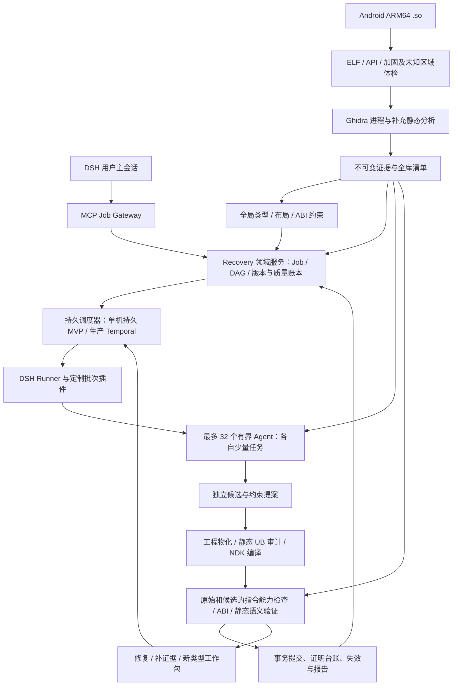

# Android ARM64 `.so` 全自动 C++ 源码重建方案 V1

> 版本：1.0-design。状态：经用户批准整合的设计基线，尚未实现恢复系统。
>
> 更新日期：2026-10-13（Asia/Singapore）。基础调研日期：2026-10-12。
>
> 本版统一需求、架构、数据契约、DSH 多 Agent 与插件、实施及验收。替代 0.2-draft；历史版本保存在 [0.2 快照](snapshots/android-arm64-so-cpp-recovery-0.2-DRAFT-2026-10-13.md) 和 [0.1 快照](snapshots/android-arm64-so-cpp-recovery-INITIAL-2026-10-12.md)。

> 实施状态：本设计中的规划与既有调研记录保留为基线；M0 开发已启动，当前代码能力、实际验证和未完成项以[实施记录](implementation-status.md)为准。
>
> 用户本轮批准六项优化，并明确采用多 Agent、每个 Agent 少量任务、可配置 32 路并发，以及 DSH 定制插件。32 是设计容量上限与验收档位，当前尚未修改用户 DSH 安装配置，也未测得持续吞吐。

建议以 Dryxio/reagent 为二创基础，改造 ghidra-bridge，补建 Android ARM64 静态分析、类型/ABI、C++ 工程生成和独立语义验证。DSH 负责客户端及有界 Agent Runtime，领域服务持有任务、契约和质量结论，生产持久编排预选 Temporal。

产品定义：输入 Android `arm64-v8a` `.so`，全自动生成带证据追踪的 C++ 重建工程，实际编译链接候选，并分别报告完整性、构建、ABI、语义及缺口。可以追求高质量语义重建，不能保证恢复已被编译删除的名称、模板来源、宏、注释或原始工程结构，也不能承诺任意 `.so` 的完整无界等价。

本版的接口、插件包、命令及示例为拟开发规范；源码核查支持设计取舍，不代表已经完成 Android 恢复实验或 DSH 实际模型联调。性能及工期目标在 M0 后冻结到具体配置与样本。

## 一、需求与技术选型

### 1. 已确认的需求范围

| 项目 | 本次设计约束 |
|---|---|
| 目标平台 | 仅 Android |
| 目标架构 | 仅 `arm64-v8a` / AArch64 |
| 输入形式 | ELF64 共享库 `.so` |
| 输出语言 | C++，允许声明过的 NDK 编译器扩展和 ARM Intrinsics |
| 工作方式 | 每个任务全自动，无需人工选择函数、修复类型或修改工程 |
| 分析方式 | 纯静态 |
| 加固范围 | 允许部分混淆；排除需要运行时解密或生成代码的区域 |
| 模型策略 | 质量优先，允许较大的 Token 消耗 |
| 项目策略 | 允许二创现有开源项目 |
| 质量判定 | 编译、ABI、语义和完整性分别报告 |
| 最终目标 | 可维护、可编译、尽可能保留原库行为的 C++ 工程 |

“纯静态”允许反汇编、反编译、编译和链接候选源码，以及符号语义分析、SMT 求解；禁止运行原始库、候选库、测试 Harness、模拟器或设备程序。`.init_array`、`JNI_OnLoad` 等入口只分析，不调用。

### 2. 两个参考仓库的核查结果

本次下载并检查了实际源码，固定到以下提交：

| 仓库 | 核查提交 | 代码中的版本 | 定位 |
|---|---|---|---|
| meyz664K/auto-re-agent | [`be6f77c`](https://github.com/meyz664K/auto-re-agent/tree/be6f77cb9ae1ad74011e27e05eea6b959dae132e) | `0.1.0` | 较早的 Reverser / Checker MVP |
| Dryxio/reagent | [`d12cea3`](https://github.com/Dryxio/reagent/tree/d12cea338c61898b06a86fe8adb25275fa9d5615) | `0.4.0` | 已扩展的证据、候选验证和任务管理框架 |
| Dryxio/ghidra-bridge | [`faaf053`](https://github.com/Dryxio/ghidra-bridge/tree/faaf05363796cbc43eac7924f3b6981cd5e40619) | 单独包 | Ghidra 数据导出与查询层 |

两个参考项目的包元数据、模块结构和作者信息存在明显延续关系。因此，它们更适合视为同一类方案的不同发展阶段，不能作为两个独立技术路线的效果对照。

#### 2.1 meyz664K/auto-re-agent

主要流程：

```text
选择函数
  → 从 Ghidra 获取上下文
  → Reverser 生成 C++
  → Checker 检查
  → 根据意见修复
  → 输出代码、Parity 报告和进度
```

修复循环在 LLM Checker 返回 `PASS` 后即可设置 `success=True`。后续 Parity 检查保留了原成功状态，没有把结构风险统一纳入最终成功判定。[修复循环源码](https://github.com/meyz664K/auto-re-agent/blob/be6f77cb9ae1ad74011e27e05eea6b959dae132e/src/re_agent/agents/loop.py#L101)、[单函数编排源码](https://github.com/meyz664K/auto-re-agent/blob/be6f77cb9ae1ad74011e27e05eea6b959dae132e/src/re_agent/orchestrator/single.py#L61)

- 适合学习双角色生成与修复循环。
- 支持函数级代码生成及基本进度管理。
- 成功状态偏向模型判断。
- 缺少从裸 `.so` 自动生成完整工程的链路。
- 缺少独立的机器语义验证层。

不建议以这个版本作为主要二创起点。

#### 2.2 Dryxio/reagent

主要流程：

```text
目标规划与依赖选择
  → 收集反编译、汇编、CFG、P-code 等证据
  → Reverser 生成或修复候选
  → Checker 审查
  → Objective Verifier 检查结构差异
  → 候选工程 Overlay
  → 配置的构建、测试及 Parity 门禁
  → 保存检查点、历史和覆盖率
```

| 可复用模块 | 现有价值 |
|---|---|
| Backend Protocol | 分析后端能力抽象 |
| Reverser / Checker | 角色隔离与修复反馈 |
| Evidence Investigation | 按需查询额外静态证据 |
| Target Plan | 有边界的函数与调用依赖清单 |
| Candidate Overlay | 隔离候选修改 |
| Session / Identity | 检查点、历史和过期结果识别 |
| Knowledge Graph | 函数、调用、字符串及全局量关系 |
| Reports / Coverage | 结果和检查过程可追踪 |
| LLM Provider | 多种模型接口适配 |

| 缺口 | 源码核查结论 | 二创要求 |
|---|---|---|
| 裸二进制启动 | 仍需准备 Ghidra 项目及配置 | 自动创建项目、导入、分析、导出 |
| 工程初始化 | Overlay 主要面向已有项目或单个候选文件 | 从零生成头文件、源文件、构建和导出配置 |
| 全局类型恢复 | 依赖已有类型、符号及源码上下文 | 新建跨函数类型与布局约束求解器 |
| 语义验证 | Objective 主要比较调用、分支和部分常量 | 新建机器语义比较层 |
| Android 专项 | 通用 C++ Profile 不能覆盖完整 Android ABI | 新建 Android ARM64 Profile |
| 完整性 | Manifest 覆盖率针对选定清单 | 增加全库、字节区域及入口闭包覆盖率 |
| 静态限制 | 支持执行测试、Runtime 和差分 Harness | 本方案禁用这些路径 |

`verification/objective.py` 的 `PASS` 表示没有发现所检查的结构差异，不能解释为语义等价。修复循环允许 Objective 的 `UNKNOWN` 不直接阻断候选成功。[Objective Verifier](https://github.com/Dryxio/reagent/blob/d12cea338c61898b06a86fe8adb25275fa9d5615/src/re_agent/verification/objective.py)、[修复循环](https://github.com/Dryxio/reagent/blob/d12cea338c61898b06a86fe8adb25275fa9d5615/src/re_agent/agents/loop.py#L165)

现有差分验证会执行参考与候选 Harness，不能作为本方案的验收路径。[差分验证源码](https://github.com/Dryxio/reagent/blob/d12cea338c61898b06a86fe8adb25275fa9d5615/src/re_agent/verification/differential.py)

结论：复用 Dryxio/reagent 的编排基础，重建其质量判定和 Android 二进制到完整工程的核心链路。

#### 2.3 ghidra-bridge 的关键限制

1. 导出器打开已有 Ghidra Program，并设置 `analyze=False`，没有承担从输入 `.so` 自动导入和完成分析的职责。
2. Vtable 导出依赖符号名称及指针扫描，不足以覆盖无 RTTI、多继承、构造期虚表等完整 C++ 对象模型。
3. High P-code 操作数以字符串形式导出，缺少证明引擎所需的显式位宽、地址空间、内存语义和结构化操作数。

以上可在[导出器源码](https://github.com/Dryxio/ghidra-bridge/blob/faaf05363796cbc43eac7924f3b6981cd5e40619/ghidra_ai_bridge/exporters/runner.py)中核查。

reagent 当前按固定字符数裁剪证据，JSON 内容也会缩减列表、字段和深度。本项目应改成可分页、可追踪、带完整性标记的检索，禁止静默裁剪关键分支、调用目标或内存访问。[证据裁剪源码](https://github.com/Dryxio/reagent/blob/d12cea338c61898b06a86fe8adb25275fa9d5615/src/re_agent/utils/evidence.py)

#### 2.4 初稿记录的历史验证

| 项目 | 本地测试结果 |
|---|---|
| meyz664K/auto-re-agent | 63 通过 |
| Dryxio/reagent | 197 通过、2 跳过 |

测试使用 `not llm and not ghidra` 标记筛选。结果支持对仓库工程基础的判断，不代表已完成 Ghidra 集成、DeepSeek 调用或 Android `.so` 还原验证。

上述测试数为 0.1 初稿记录；2026-10-13 的本轮复核未重跑这些测试。它们不能充当 V1 恢复系统或 DSH 兼容性验收。

### 3. 补充项目、论文及社区实践

| 技术／项目 | 可借鉴部分 | 对本需求的限制 |
|---|---|---|
| [LLM4Decompile](https://github.com/albertan017/LLM4Decompile) | 汇编到源码、反编译精修、公开评测 | 主要支持 Linux x86-64 到 C，不能代表 Android C++ 效果 |
| [Decompile-Bench](https://arxiv.org/abs/2505.12668) | 二进制—源码配对、泄漏控制 | 需另建 Android ARM64、完整共享库和 C++ ABI 数据集 |
| [SK²Decompile](https://arxiv.org/html/2509.22114v1) | 先恢复结构，再恢复名称 | 数据主要来自 C 与 x86 Linux 配置 |
| [ReF Decompile](https://arxiv.org/abs/2502.12221) | 跳转重标记、调用信息补充类型 | 可用于输入规范化，不提供完整共享库重建 |
| [DeGPT](https://www.ndss-symposium.org/ndss-paper/degpt-optimizing-decompiler-output-with-llm/) | 多角色精修、可读性 | 模型审查不能替代语义验证 |
| [Agent4Decompile](https://arxiv.org/html/2604.23940v2) | 分层约束与修复反馈 | 正文范围 C／x86-64，行为门禁依赖执行 |
| [AutoDecompiler](https://arxiv.org/html/2606.16162v2) | 多轮反馈及避免修复退化 | 使用编译、执行和输入输出反馈，不能整体照搬 |
| [D-Helix](https://www.usenix.org/conference/usenixsecurity24/presentation/zou) | 重编译与符号模型差异检测 | Android ARM64、C++ 和环境模型需移植 |
| [rev.ng](https://docs.rev.ng/references/artifacts/) | 显式模型、可重编译 C 和工程产物 | Android ABI 和 C++ 质量需实测 |
| [TYGR](https://www.usenix.org/conference/usenixsecurity24/presentation/zhu-chang) | 数据流图推断基本及结构类型 | 推断结果作为候选，不作为确定事实 |

Agent4Decompile 的摘要页与所查 v2 PDF／正文的效果数字存在差异。本方案不采用摘要页上的高成功率作为预期；正文也排除了混淆及 x86-64 以外架构。[论文 PDF](https://arxiv.org/pdf/2604.23940v2)

社区游戏反编译实践说明长期编排、CI、进度与候选回滚的重要性，但包含人工协作，不能作为纯静态、无人干预的效果证明。[作者技术文章](https://momo5502.com/posts/2026-10-09-game-decompilation/)

### 4. 工具选型建议

| 层级 | 首选 | 补充／备选 | 原则 |
|---|---|---|---|
| ELF 解析 | LIEF | LLVM ELF 工具 | 两路核查关键结构 |
| 主分析 | Ghidra Headless | — | 自动导入、分析和结构化导出 |
| 指令核查 | Capstone／LLVM | — | 边界与解码差异 |
| 第二反编译器 | RetDec 或 rev.ng | 商业后端可选 | 发现分歧，不用多数票证明 |
| C++ 类型 | 自研约束求解 | Ghidra RTTI、研究型推断 | ABI 规则优先 |
| 编译 | Android NDK Clang | 固定历史 NDK | 固定 sysroot、运行库和配置 |
| 语义求解 | Z3 等 SMT Solver | 独立求解器复核 | 保留 UNKNOWN |
| 编排 | Dryxio/reagent | 持久任务层 | 改造成功语义 |

Ghidra HeadlessAnalyzer 不是线程安全的，分析任务采用进程隔离。[官方 API](https://ghidra.re/ghidra_docs/api/ghidra/app/util/headless/HeadlessAnalyzer.html)

不能直接把 angr 当成完备的 ARM64 验证后端；选定版本需核查 AAPCS64 大类型参数和 Solver 超时问题。[AAPCS64 议题](https://github.com/angr/angr/issues/7028)、[超时议题](https://github.com/angr/angr/issues/7226)

`Ghidra-Cpp-Class-Analyzer` 已归档，适合参考算法。优先评估 Ghidra 自身类恢复逻辑，再补 Android 专项。[归档项目](https://github.com/astrelsky/Ghidra-Cpp-Class-Analyzer)、[内置脚本](https://github.com/NationalSecurityAgency/ghidra/blob/master/Ghidra/Features/Decompiler/ghidra_scripts/RecoverClassesFromRTTIScript.java)

## 二、统一架构与 Android 二进制证据

### 5. 产品目标和结果等级

| 质量维度 | 回答的问题 |
|---|---|
| 源码完整性 | 已恢复哪些函数、数据、入口和依赖？ |
| 构建状态 | 模块或完整工程是否真实编译和链接？ |
| ABI 状态 | 导出、调用约定和对象布局是否通过静态检查？ |
| 语义状态 | 在什么输入域、边界及环境假设下验证了什么？ |

| 等级 | 产物含义 | 允许声明 |
|---|---|---|
| A0：分析完成 | 证据、清单和缺口报告 | 完成自动分析 |
| A1：部分源码 | 部分函数／模块及编译对象 | 部分源码可编译 |
| A2：完整构建候选 | 目标范围内完整工程及构建成功的 `.so` | 工程可构建，语义状态单独报告 |
| A3：范围内静态验证 | 指定入口闭包通过声明范围验证 | 在列明条件下通过静态语义验证 |

“完整”必须附带范围。未解析间接调用、缺失内部函数或未知区域不能被忽略。单函数通过不能升级为全库通过，有限边界验证不能升级为无界等价。

Job 的执行终态不再编码质量等级。`COMPLETED` 仅表示本次计划已结束，最终等级和语义维度按第 23、29、39 节单独给出。A3 必须附具体入口闭包、前提、环境和边界，有限或条件化结论不可展示成整库无界等价。

### 6. 总体架构



用户主会话只提交、查询、解释和接收用户的目标调整，不持续记忆整库。后端根 Session 只承载一个 Job 的有界批次，确定性插件执行服务冻结的计划。LLM 输出假设、候选或修复提案；它不能直接改验收状态或接受分支。

DSH 会话树描述执行归属；业务工作包 DAG 描述调用、类型、数据及证明依赖。二者分别维护。关闭客户端不取消 Job。复杂对象、SCC 和大函数可拆成多个有界调查包，但闭合前保持条件化/未知。

### 7. 模块划分与职责

| 模块 | 输入 | 输出 | 职责 |
|---|---|---|---|
| Intake | `.so`、可选依赖 | 清单与指纹 | 格式、架构、区域及依赖初检 |
| Android ELF Loader | 文件结构 | 逻辑内存映射 | 重定位、符号、TLS、动态标签 |
| Analysis Worker | 逻辑映射 | 指令、函数、CFG、反编译 | Ghidra 及补充解码 |
| Evidence Store | 分析结果 | 版本化证据 | 原始事实、来源、完整性和分页 |
| Inventory Builder | 代码和数据证据 | 全库清单 | 入口、函数、数据及未知区域 |
| Type / ABI Solver | 数据流和规则 | 类型候选与接口契约 | 跨函数传播与布局约束 |
| Dependency Planner | 调用及类型图 | SCC 与调度顺序 | 循环依赖、失效与批次 |
| Project Generator | 接口与模块 | C++ 工程 | 头文件、源文件、导出和构建 |
| LLM Workers | 证据与契约 | 源码与假设 | 恢复、审查、命名和修复 |
| Build Gate | 候选工程 | 构建诊断 | 编译实际候选 |
| Semantic Verifier | 原始及候选语义 | 证明、反例或未知 | 位精确比较与范围 |
| Artifact / Report | 所有结果 | 分级代码和报告 | 覆盖率、缺口和台账 |

首版使用单机任务服务、数据库和文件对象存储。按实测并发与存储需要再拆分服务。

| 新增运行组件 | 职责与边界 |
|---|---|
| Durable Orchestrator | 只负责合法调度、资源排队及故障恢复，不拥有类型或等价判定权 |
| DSH Runner Adapter | SDK 启动、固定 Profile、批次根 Session、生命周期与业务 ID 映射 |
| DSH Recovery Plugins | 工作包执行、证据工具、提案提交、控制通道、审计；通过正式扩展点接入 |
| Domain Commit Service | 校验身份/版本/指纹，原子记录结果及事件，生成质量视图 |

分析、构建、验证为确定性 Tool Activity；不为每个工具再创建 LLM Agent。语言边界建议：复用的 Python 领域/分析模块与 TypeScript DSH 插件通过版本化 JSON 契约通信，凭据和租约由宿主传递。

### 8. Android ELF 专项处理

- ELF64、`EM_AARCH64`、Little Endian、共享对象识别。
- Program Header 与 Section Header 交叉核查。
- `.dynsym`、`.symtab`、符号可见性与版本。
- `DT_NEEDED`、SONAME、GOT、PLT、导入符号。
- RELA、RELR、Android Packed Relocations。
- `.init_array`、`.fini_array`、TLS、异常和展开信息。
- `.rodata`、`.data.rel.ro`、可写全局量、BSS。
- `JNI_OnLoad`、静态 JNI 导出与动态注册表。
- BTI／PAC 特征和 ELF 属性。

Android 使用 ELF 和 Little Endian；C++ 名称修饰与 Generic／Itanium ABI 有关。[Android ABI](https://developer.android.com/ndk/guides/abis)

Packed Relocations 与 RELR 不正确会影响虚表、函数表和全局指针。[Bionic 文档](https://android.googlesource.com/platform/bionic/+/HEAD/android-changes-for-ndk-developers.md)、[LIEF 接口](https://lief.re/doc/latest/doxygen/ELF_2Relocation_8hpp_source.html)

仅凭 ELF 不能可靠确定全部原始 API、NDK 和编译参数。报告记录观察线索、最低 API 推断下界、实际重建配置及不确定配置，不把成功链接配置称为原始配置。

#### Android 兼容性 Profile

每个任务冻结 `android_profile_id`，同时保存观察到的特性、最低 API 推断下界、未知配置、实际重建 NDK/API/运行库和加载环境假设。推断下界不等于原始编译参数，也不等于应用完整兼容性。

| 特性 | Profile 必须区分的内容 |
|---|---|
| 映射与头信息 | PT_LOAD 为逻辑映射基础；Section Header 做交叉核查和平台合法性检查；缺失与损坏分别报告 |
| TLS | ELF native TLS 与 emutls；ELF TLS API 29 起支持，NDK r26 对 minSdk 29+ 默认启用 |
| Packed / RELR | API 23 起的 packed relocations；API 28 的 Android 私有 RELR 常量；API 30 的正式 ELF 常量；格式与 API 分开记录 |
| IFUNC / IRELATIVE | 解析 resolver 和可能目标，仅静态分析；不能调用 resolver 确定地址 |
| 加载与符号 | SONAME、DT_NEEDED、版本、可见性、绑定/抢占、动态查询和命名空间假设 |
| 生命周期 | 重定位完成、初始化顺序、TLS 析构与依赖库加载/卸载关系 |
| 页大小 | PT_LOAD 对齐、RELRO 范围、源码固定 4096 假设与可用依赖，区分 4KB/16KB 配置 |

Bionic 在 API 24+ 对缺失 Section Header 有合法性要求。无节表输入可做区域分析，但不能笼统宣称为该平台可加载的正常共享库。私有依赖和未解析的动态查找也会限制完整兼容性结论。[Bionic 官方规则](https://android.googlesource.com/platform/bionic/+/HEAD/android-changes-for-ndk-developers.md)

16KB 静态检查不只看 LOAD 对齐，也检查 RELRO 边界及代码里的固定页大小假设；只输入 `.so` 时 APK ZIP 对齐与应用打包状态标为未提供，设备行为不进入本项目验收。[Android 16KB 指南](https://developer.android.com/guide/practices/page-sizes)

### 9. 函数和代码区域发现

多来源：符号、展开信息、直接调用／尾调用、虚表／回调表、JNI 注册、初始化／析构入口、经验证指令扫描及第二后端。

可执行区域状态：

```text
已解码代码
函数边界待确认
代码／数据归属不确定
工具不支持的指令
疑似加密或运行时生成区域
```

未知样本报告已发现清单覆盖率；验收样本使用隔离真值计算实际召回。

### 10. 证据层：两种 IR

| 表示 | 用途 | 限制 |
|---|---|---|
| 原始指令及 Raw P-code | 机器语义、位宽、内存访问 | 依赖解码器与 Lifter |
| High P-code、反编译 C、CFG | 类型、结构、LLM 上下文 | 可能受类型猜测及优化影响 |

不以反编译文本单独代表原始语义。保留有符号／无符号、移位、内存及浮点区别。[P-code 参考](https://ghidra.re/ghidra_docs/languages/html/pcoderef.html)

IR 操作包含原始地址及字节、操作码、输入输出位宽、地址空间、结构化操作数、基本块、控制流、异常／终止属性、工具版本。原始证据不可改写，假设另存并引用证据 ID。

#### Raw IR 的可信边界

成功解码、得到 Raw P-code 和语义模型完整是三个不同事实。`CALLOTHER` 允许未完整规定的副作用；核查的 ARM64 SLEIGH 中，LDXR 可提升为普通读取，DMB 通过用户操作表达。因此既要检查 IR 操作，也要按原始指令字节、opcode/扩展、寄存器及处理器状态核验两侧能力，不能仅扫描未知 IR opcode。

建立从原始指令到结构化 IR 的来源映射及 `semantic_capability_id`。缺失独占监视器、内存顺序、FPCR/FPSR、异常或陷阱等语义时，即使提升成功，也不能进入精确等价路径。第二解码器仅能核查边界和解码，不能验证缺失的处理器语义。[P-code 伪操作](https://ghidra.re/ghidra_docs/languages/html/pseudo-ops.html)、[核查的 ARM64 SLEIGH](https://github.com/NationalSecurityAgency/ghidra/blob/918d44ebc2962a53d23eeee52b8f44c7816e7815/Ghidra/Processors/AARCH64/data/languages/AARCH64base.sinc)

机器字节、分析事实、可校验变换和未证实假设分层保存；对原始事实的“修正”产生新版本，不能覆盖历史来源。

### 11. 全局类型恢复

采用约束求解与候选推断，证据优先级：

```text
有效 DWARF 与明确 ABI 元数据
  > 动态符号及可确认导入声明
  > RTTI、重定位和布局证据
  > 跨函数数据流
  > 编译器／运行库模式
  > LLM 或学习模型推断
```

约束来自访存宽度／偏移、有符号性、参数返回流、分配与构造写入、虚调用对象调整、外部接口、常量及字符串。冲突保留多个候选，检查全部相关约束；无法收敛时保留低层表示与不确定性。

### 12. C++ 类与对象布局恢复

| 能力 | 证据 |
|---|---|
| 类名与继承 | RTTI、修饰符号 |
| Vptr 与虚表地址点 | 重定位、对象写入、虚调用 |
| 多继承 | 子对象、this 调整、Secondary Vtable |
| 虚继承 | 虚基偏移、VTT、构造期虚表 |
| 构造／析构变体 | 符号、调用、Vptr 写入、释放 |
| 字段布局 | 偏移、宽度、生命周期 |
| 成员函数指针 | AArch64 C++ ABI |
| 静态局部对象 | Guard Variable、初始化调用 |

同时参考 [Generic C++ ABI](https://itanium-cxx-abi.github.io/cxx-abi/abi.html) 与 [AArch64 补充](https://github.com/ARM-software/abi-aa/blob/main/cppabi64/cppabi64.rst)。无法确认的类可以显式布局表达，改写自然继承结构需再验证。

自然类结构不是必须恢复的唯一表达。显式布局结构和经核验的辅助函数可以作为首个保真产物；跨库对象布局、虚表地址点、成员函数指针和异常 ABI 都通过后，才提升为更自然的 C++ 类。

### 13. AAPCS64 调用约定

覆盖参数寄存器和栈参数、浮点／SIMD、HFA／HVA、小型聚合、间接返回与 x8、可变参数、栈对齐、寄存器保存、非平凡 C++ 类型、this 调整、Thunk、尾调用、Android 平台寄存器约束。不能根据寄存器数量直接猜参数。[AAPCS64](https://github.com/ARM-software/abi-aa/blob/main/aapcs64/aapcs64.rst)

Android `arm64-v8a` 的 `long double` 为 IEEE binary128，x18 为平台保留寄存器。调用/返回 ABI 检查包含这些规则，不能沿用 x86 或通用 Linux 类型尺寸。[Android ABI](https://developer.android.com/ndk/guides/abis)

### 14. JNI 恢复

识别 Java_*、JNI_OnLoad、JavaVM／JNIEnv；恢复可静态确定的 JNINativeMethod 表；传播方法名、签名、函数指针和注册类；将注册目标纳入入口。保留 VM 外部环境假设。

不能假设全部 Native 都有 JNIEnv 参数，CriticalNative 需区分；仅 `.so` 可能缺少 DEX 注解与类上下文。[JNI 文档](https://developer.android.com/ndk/guides/jni-tips)

动态拼接且不可求值的注册信息产生缺口，不伪造。

JNI Profile 区分普通 Native、FastNative、CriticalNative、显式注册和名称查找，以及所需 Android API 条件。CriticalNative 的 ABI 不含 `JNIEnv`/`jclass`，动态查找的版本支持不同；缺失 DEX 注解或类上下文时保留 ABI 候选与缺口，不由命名推断替代证据。[JNI 官方说明](https://developer.android.com/ndk/guides/jni-tips)

### 15. 部分混淆处理

| 类型 | 策略 |
|---|---|
| 常量混淆 | 位向量化简与常量传播 |
| 不透明谓词 | 条件和可达性求解 |
| 平坦化 | 状态变量、Dispatcher、转移关系 |
| 冗余分支／死块 | 证明不可达后删除 |
| 间接跳转 | 值域、表项、重定位和数据流 |
| 静态可解字符串变换 | 分析语义并保留证据 |
| 运行时解密／生成代码 | 排除区域 |

保存转换前后 IR、规则、前提与验证结果。排除区域的影响传播到调用及数据依赖；独立区域继续处理，受影响入口不能最高等级通过。

### 16. 工程生成

```text
recovered/
├── CMakeLists.txt
├── CMakePresets.json
├── toolchain-lock.json
├── include/
│   ├── recovered_api.hpp
│   ├── recovered_types.hpp
│   └── recovered_layouts.hpp
├── src/
│   ├── module_*.cpp
│   ├── globals.cpp
│   ├── jni_bindings.cpp
│   └── initializers.cpp
├── abi/
│   ├── exports.map
│   └── abi-manifest.json
├── evidence/source-map.json
├── verification/
│   ├── contracts.json
│   ├── proof-ledger.json
│   └── counterexamples/
└── reports/
    ├── summary.md
    ├── coverage.json
    └── gaps.json
```

构建使用受控模板，LLM 不自由修改构建脚本或添加执行命令。固定 Android ABI、NDK、API、sysroot、运行库、构建参数；保留导出属性及 SONAME；实际实现初始化、全局数据及业务行为。禁止调用原 `.so`、复制 `.text`、保留跳板冒充恢复。

libc++ 静态／共享选择进入兼容性约束。[运行库文档](https://developer.android.com/ndk/guides/cpp-support)

页大小与 ELF 对齐进入检查；静态判断不替代设备运行验证。[16 KB 页文档](https://developer.android.com/guide/practices/page-sizes)

跨库传递 STL 对象、分配/释放、异常和 RTTI 时，必须核对依赖的 libc++ ABI 与版本；不得为了链接成功任意更换运行库。只提供目标 `.so` 而缺依赖时，冻结可说明的外部接口与假设，未知保留在闭包报告。[NDK 运行库约束](https://developer.android.com/ndk/guides/cpp-support)

生成工程的业务源码规范见第 25 节；每个实际构建产物都单独绑定源码、NDK、sysroot、参数、ABI 与语义结果。

## 三、DSH 多 Agent、小工作包与插件

### 17. 工作包拆分、上下文和轮换

每个大阶段都拆为可调度工作包。首版默认 **一个工作 Agent 同时只处理一个工作包、一个角色、一个冻结输入版本**；恢复包通常对应一个函数的一种候选方向。多个候选由多个 Agent 并行提出，审查和修复使用独立工作包。

| 阶段 | 工作单位 | 可并行 | 需服务串行合并的内容 |
|---|---|---|---|
| 分析/入口 | 一个代码区域、函数或注册表疑点 | 静态查询、候选边界 | 区域去重、边界/入口闭包 |
| 类型/ABI | 一个约束组件的有界提取批次 | 多函数约束提取 | 冲突求解、契约冻结 |
| 恢复 | 一个函数的一种实现候选 | 不同函数/候选方向 | 当前契约下集成 |
| 审查 | 一候选、一组相关义务 | 独立候选及维度 | 强差异传播 |
| 修复 | 一个候选的少量相关失败 | 不相关失败 | ABI/公共类型变更与失效 |
| 大函数/SCC | SESE、循环、状态机或有界调查 | 已声明边界下提案 | 效果合成、递归及全函数证明 |
| 集成/报告 | 一模块候选集或验收记录 | 独立模块 | 公共声明、最终链接、账本汇总 |

简单且共享接口的小函数可实验性合为 1–4 个，默认仍为 1 个。大型 SCC 不能仅按数量拆分后宣称独立；大函数区域必须有入口/出口、读写、控制副作用和合成义务。

工包冻结目标、证据清单、依赖、允许修改范围、交付及停止条件。输入证据按 ID 分页提供，32–64K tokens 可作为初始会话上下文软目标，具体由 M0 测量。软目标用于切分和轮换，不能静默裁剪必要证据；无法安全切分时显式扩大有界任务或报告能力缺口。

一个 Activation 内允许必要的多轮工具交互与短修复；达到软上下文目标、角色或输入变化、重复错误、完成交付时释放。后续工作由新 Agent 接续交接快照；确有必要的同版本短修复可续用 Session，但每个新 Activation 必须重新绑定 Attempt、Schema 和限制。

交接至少含 Task/Attempt/输入版本、最佳候选与诊断、已读/未读证据项、强差异、未知、假设、下一步和停止条件。摘要是索引，证明与闭包使用完整规范化产物。主会话只接收小型状态视图，完整证据、会话和工具历史留在后端可追踪。

三层记忆分别为当前会话、可校验交接快照、领域事实库。事实与接受状态只由领域服务更新，跨工包通过版本化事实而不是群聊传递。

### 18. 角色、权限与输出

| Agent | 工作包职责 | 允许输出 | 禁止直接操作 |
|---|---|---|---|
| Planning | 对一个有界分组提出拆分、优先级、补证据方案 | 可校验计划提案 | 全局任意创建任务、改验收规则 |
| Evidence Analyst | 处理一个区域或一个疑点 | 证据定位、边界／调用目标假设 | 改原始字节与证据 |
| Type / ABI Analyst | 一个类型组件／接口集合 | 字段、类型、ABI 约束提案 | 直接改公共头文件与契约版本 |
| Recovery | 一个函数、小组或一个区域候选 | C++ 实现、辅助声明、假设、证据引用 | 写接受分支、任意构建脚本 |
| Reviewer | 一个候选及其规定证据 | 问题、遗漏、待验证义务 | 提升 A 等级、修改候选 |
| Repair | 一组有界失败诊断 | 新候选及修改范围 | 忽略强差异、删除困难路径 |
| Integration Analyst | 一个模块或一批接口冲突 | 组合方案、冲突解释 | 无版本检查改共享源码 |
| Naming / Organization | 已稳定候选的限定范围 | 命名与组织候选 | 未经重验证替换实现 |
| Reporting | 一个模块或 Job 的验收记录 | 来源可追踪说明 | 自行宣称未通过部分成功 |

Agent 是有工具调用和多轮反馈的执行者，不只是一次补全文本。编译器、Lifter、Solver 等是 Tool Activity，不强行包装成判断真假的 LLM Agent。

Reviewer 不继承生成者的聊天过程，使用原始证据、契约和候选独立检查。模型一致意见只产生辅助证据，最终状态由第 23、27、29、44 节对应服务决定。

工作者不拥有再委托、任意 Shell、插件安装/动态代码执行或接受分支写入工具。根只拥有受控批次与状态查询能力。角色工具允许表按运行中的 Agent/Attempt 绑定，不能仅相信模型声明的角色。

### 19. DSH Runtime 拓扑与生命周期

客户端采用官方 DSH；后端宿主通过 DSH SDK 启动专用 Runtime，再由定制插件使用本地 Fresh Spawn。优先浅层根 → 工作者树，模块协调为持久逻辑分组。根不自行决定全库排程，也不接收所有子聊天历史。

每个 Runtime 同时只运行一个 Job 的一个有界批次，最多 32 个工作子 Activation。不同 Job、Profile 或租约不共享运行中的批次根。各批次逐项提交结果，不等整批结束才持久化；批次结束后释放 Activation，再以新根/进程运行后续批次。

| DSH 模式 | V1 使用边界 |
|---|---|
| 本地 Spawn | 默认；Fresh 上下文，可设置结构化结果、工具允许表、角色和深度 |
| Fork | 少量必要的同背景第二意见；已完成父历史快照，不替代最新工包契约 |
| `dsh-subagent-dsh-sdk` | 备选；外部 Runtime 不支持父级 outputSchema/toolFilter/Persona/数值深度，也不接受后续消息 |
| 原生 Workflow | 可选可信批次执行适配，不承担全库持久状态 |
| Experimental Team | 不作为业务账本；后续展示/实验可评估 |

Runner 流程：冻结 ready 清单 → 校验 Profile/容量/工具 → SDK 启动 → 绑定批次根 → 插件逐项 `startActivation` → 证据调查/提交 → 独立检查 → 逐项记录/修复 → 确认清理。程序侧采用 `delivery: 'caller'`，根只读批次摘要。

SDK 的 `finalResponse` 是活动区间最后根响应，不是按业务输入归属的产物证明。一个 Session 不同时塞入无关提示；事件/结构化提案必须按业务身份校验。原生 `agent()`/`completed`/工具返回也不升级源码质量。[SDK 说明](https://github.com/deepseek-ai/deepseek-harness/blob/d743267388641bc76f17c45ce8b4c231aed1d32c/packages/sdk/client/README.md)

会话可持久保留，Activation 是一次活动执行。Attempt 对应一个 Activation；同一 Session 的后续 Activation 生成新 Attempt。进程失败或输入失效重发新 Attempt/epoch；检查当前提案已提交则先读取回执，不重复覆盖。Session 在多个进程之间不得同时恢复，持久 mailbox/租约由本项目服务管理。[Subagent 生命周期](https://github.com/deepseek-ai/deepseek-harness/blob/d743267388641bc76f17c45ce8b4c231aed1d32c/packages/subagent/subagent/README.md)

SDK 当前没有逐 prompt 的 mid-turn cancel。定制插件维护精确 Activation handle 与控制通道，取消后调用 dispose 并等待清理；不可达时宿主关闭该 Job Runtime 并确认进程及所辖工具资源退出。客户端断开、Agent interrupt、Job 取消分别记录。

### 20. 定制插件：正式实施边界

DSH 基于 Cordis 插件组成。V1 将定制能力作为正式模块，通过服务注入、工具注册、作用域限制及生命周期钩子实现，而不是修改官方核心循环。下列包名和服务名为本项目拟开发能力，尚不存在。

| 拟开发插件 | 能力 | 对接点与依赖 |
|---|---|---|
| `recovery-task-context` | 绑定工作包/Attempt/Session/Activation，注入角色和冻结快照，交接与轮换 | Agent 创建/请求生命周期、作用域服务 |
| `recovery-evidence-tools` | 完整清单、分页证据、结构化 IR、契约与诊断读取 | `ctx.tools.register(defineTool(...))`，领域证据代理 |
| `recovery-proposal-tools` | 候选/约束/补证据提交及回执查询 | typed tools，范围/版本/指纹/幂等校验 |
| `recovery-batch-runner` | 冻结清单 fan-out/fan-in、32 路名额、结果逐项持久化 | `ctx.subagents.startActivation`、独立领域提交服务 |
| `recovery-static-policy` | 根/子允许表、单调工具拒绝、禁止动态扩权 | `ctx.tools.restrict`、`ctx.tools.guard`、受控 Tool Activity |
| `recovery-control-audit` | 精确取消、资源清理确认、心跳、事件/用量/身份映射 | 专用鉴权本地 IPC/控制端点，生命周期及 `tools/result` |
| `recovery-job-view` | Job 视图、远程工作者和产物投影 | 后续 C3 UI 扩展，不伪装本地 Session |

DSH 原生 `defineTool` 提供参数/输出契约；`restrict` 限制 Agent 可见工具；`guard` 用于不得被后续插件放宽的拒绝规则。插件 `inject` 声明依赖，不能靠配置行先后顺序保证加载完成。[工具注册与限制](https://github.com/deepseek-ai/deepseek-harness/blob/d743267388641bc76f17c45ce8b4c231aed1d32c/packages/core/tools/README.md)、[官方插件教程](https://github.com/deepseek-ai/deepseek-harness/blob/d743267388641bc76f17c45ce8b4c231aed1d32c/docs/cordis-tutorial/01-first-plugin.md)、[扩展机制](https://github.com/deepseek-ai/deepseek-harness/blob/d743267388641bc76f17c45ce8b4c231aed1d32c/docs/cookbook/extension-cookbook.md)

证据工具返回 manifest/version、读取范围、总项数、cursor、content hash 和完整性标记。未读内容明确登记；候选工具返回提案回执，不含验收通过字段。构建/验证工具仅接受候选引用和固定配置引用，服务物化命令；不接受模型任意 Shell 或构建脚本。

`restrict` 对全局继承工具生效，但子作用域注册的工具仍可见。必须核查实际有效清单，静态策略 guard 同样检查作用域新增工具；本地结构化结果要求的 `structured_output` 是允许的 Runtime 终结工具，不能误拦它而使全部子任务无法完成。该工具只记录结构化结果，不拥有业务等价判定权。[结构化终结源码](https://github.com/deepseek-ai/deepseek-harness/blob/d743267388641bc76f17c45ce8b4c231aed1d32c/packages/subagent/subagent/src/structured.ts)

`recovery-batch-runner` 是首选批次执行实现：调用真实活动根 Agent 的 `startActivation`，显式传入 `outputSchema`、`toolFilter`、Persona、深度和路由，保存精确 handle；根模型仅调用受控 `run_recovery_batch(batch_ref)`，不能创建任意任务或编写调度代码。调度决定由服务产生。

原生 Workflow 的 `agent()` 当前只接受 `label`、`phase`、`schema`、`provider`、`model`，不能假设能传 `toolFilter`/Persona/maxDepth。若复用 Workflow，使用后端固定脚本与专用受控 Profile/工具代理，或经过验收的定制适配；禁止静默丢掉不支持选项。固定脚本及完整能力清单必须通过 M0-R。[Workflow 参数源码](https://github.com/deepseek-ai/deepseek-harness/blob/d743267388641bc76f17c45ce8b4c231aed1d32c/packages/workflow/workflow-ptc/src/runtime.ts)、[子创建源码](https://github.com/deepseek-ai/deepseek-harness/blob/d743267388641bc76f17c45ce8b4c231aed1d32c/packages/workflow/workflow-ptc/src/host.ts)

插件控制通道独立于 SDK stdio，可用本地 IPC 或受鉴权端点接收批次/Attempt 控制；不假定在现有 SDK `request()` 上存在任意自定义方法。任务角色不能访问此通道的控制凭据。即使只关闭整个 Runtime，也要等待所辖分析、构建、Solver 的清理回执。

插件/Profile 由发布版本管理；恢复 Agent 不获得动态安装或执行自编插件的权限。官方支持动态扩展不等于任务可以临时改变验收规则。

### 21. 32 路并发、补位与背压

用户已确认可以将 Workflow 并行 Agent 上限设为 32。V1 按 32 路工作者容量设计，仍在任务服务中排队；容量上限不是要求始终满载。每个 Agent 一次少量任务，通过增减工作者与轮换提供吞吐。

| 限制层 | V1 配置基线 | 作用范围 |
|---|---|---|
| Recovery 全局工作者配额 | 32 | 初始单机所有 Runtime 的工作子 Activation 总额，由服务/插件控制 |
| 每个 Runtime 批次 | 32 | 该批次实际 worker；单 Runtime 同时一个批次根 |
| DSH `maxActiveSubagents` | 显式 32 | 一棵 Activation 树全部活动/创建/等待/停止中子；根不占本项名额 |
| Workflow `maxConcurrentAgents` | 若启用，显式 32 | 单 Workflow 的 `agent()` 并发；`0` 自动模式在核查源码最多 16 |
| Workflow `maxTotalAgents` | 建议 64 | 单批次累计启动数；超过则拆新批次，不影响全库总工作包数 |
| PTC `maxPendingCalls` | 若启用，初始 128 | host binding 并发，需容纳结果等待、启动、清理和进度；不是 Agent 名额 |
| Ghidra / 编译 / Solver / 模型 | 独立限额 | 按 CPU/RSS/模型配额及实际延迟调节，不随 Agent 数同步设成 32 |

只修改 Workflow 仍可能撞到 Subagent 默认 8；使用 `0` 自动值也可能只得到最多 16。PTC 工具模式的 `maxParallelSubCalls` 是另一项限制；默认使用 native 工具模式，该项不作为 worker 数。多个 Runtime 的原生名额不是全局限制，必须由领域调度配额收口。[Subagent 容量](https://github.com/deepseek-ai/deepseek-harness/blob/d743267388641bc76f17c45ce8b4c231aed1d32c/packages/subagent/subagent/README.md)、[Workflow 配置](https://github.com/deepseek-ai/deepseek-harness/blob/d743267388641bc76f17c45ce8b4c231aed1d32c/packages/workflow/workflow-ptc/src/index.ts)、[PTC 通道](https://github.com/deepseek-ai/deepseek-harness/blob/d743267388641bc76f17c45ce8b4c231aed1d32c/packages/ptc-runtime/ptc-runtime-node/README.md)

起始调度可给恢复候选 24 路、审查/修复/补证据保留 8 路；这是共享的 32 路配额，不是 32+8。无其他角色任务时按策略借用；需要审查时先停止借用，等待已发任务结束，不制造嵌套等待。禁止工作者递归创建管理 Agent 占满名额。

工作者等待重型工具时只允许少量短等待；长构建/证明由持久 Tool Activity 执行，结果形成新反馈工作包后再发放 Agent。跨阶段的类型合并、ABI 冻结和最终接受事务保持有序。名额在确认 dispose/清理后归还，原生满额拒绝转回后端排队，不无限重试创建。

并发压测档位为 8/16/32，同输入、模型和质量规则，比较质量、UNKNOWN、上下文峰值、有效修复、Token、延迟、内存、事件及清理。32 路配置不保证 32 倍吞吐，也不减少单工包必要证据。

### 22. 客户端兼容、MCP 与配置交付

| 层级 | 交付 | 首版范围 |
|---|---|---|
| C1 | 用户 DSH 通过 MCP 提交/查询/取消/读取产物 | 必需 |
| C2 | 后端实际运行 DSH 有界多 Agent 与定制插件 | 首版执行实现 |
| C3 | 原生 Job 卡片/远程工作者树与记录查看 | 后续增强 |

后端 Runtime 与用户客户端不是同一会话树，后端工作者不天然出现在客户端 `list_agents`。统一展示从 `list_workers` 与授权事件投影，不伪造 Session 身份。

以下 raw MCP 名称为拟开发接口。serverName 为 `arm64_recovery` 时，在 DSH 呈现为 `mcp__arm64_recovery__<tool>`。

| 工具 | 契约 |
|---|---|
| describe_capabilities | 版本、目标、支持矩阵、Profile/工具/容量预检与连接状态 |
| submit_job | input_ref、policy_ref、幂等键 → Job ID；入队即返回 |
| get_job | 执行状态、当前版本的独立质量视图及取消/清理状态 |
| get_events | cursor 分页增量事件，重复 cursor 可重读 |
| list_workers | 本 Job Task/Attempt/Session/Activation 映射与运行状态 |
| list_artifacts | 有权限且实际存在的产物引用、指纹和验收版本 |
| read_artifact | 带明确范围及完整性标记的片段或下载引用 |
| cancel_job | 幂等取消请求回执，清理完成另查询 |

原始库通过预配置工作区/挂载/staging 登记获得 input_ref，远程客户端路径不能直接视为服务器路径。普通短工具调用控制长 Job，不依赖当前未实现的 MCP Task-required 扩展。initialize/list_tools 不创建任务；stdio stdout 仅协议、日志到 stderr。[官方 MCP](https://github.com/deepseek-ai/deepseek-harness/blob/d743267388641bc76f17c45ce8b4c231aed1d32c/packages/mcp/mcp-client/README.md)

客户端配置片段（拟开发 `arm64-recover mcp` 命令）：

```yaml
- id: arm64-recovery-mcp
  name: '@deepseek-ai/dsh-mcp-client'
  config:
    serverName: arm64_recovery
    transport: stdio
    command: arm64-recover
    args: ['mcp', '--transport', 'stdio']
    toolCallTimeoutMs: 60000
    failOnStartupError: true
```

远程使用官方 streamable-http transport、endpoint 与认证；必需插件即使失败也不一定让整个 DSH 退出，任务前必须 describe_capabilities 预检。

后端 Profile 的已核查字段配置片段如下，不是完整可安装 Profile。已有 Profile 应覆盖对应插件行，不能重复挂载同一服务。首选定制批次插件时 Workflow/PTC 两行可省略；若复用原生 Workflow，三项并发配置一起生效。

```yaml
- name: '@deepseek-ai/dsh-subagent'
  config:
    maxActiveSubagents: 32
    maxDepth: 1
- name: '@deepseek-ai/dsh-workflow-ptc'
  config:
    provider: spawn
    maxConcurrentAgents: 32
    maxTotalAgents: 64
    maxItemsPerCall: 64
- name: '@deepseek-ai/dsh-ptc-runtime-node'
  config:
    maxPendingCalls: 128
- name: '@deepseek-ai/dsh-tools'
  config:
    mode: native
- name: '@deepseek-ai/dsh-sdk-jsonrpc-server'
  config:
    maxTokensAsSuccess: false
```

`maxDepth` 是原生委托工具默认值，程序侧启动还要明确 depthLimit/禁止子再委托；配置片段只展示支持字段，没有自动保障业务配额或单工包限制。原生 Workflow 调用深度与工具限制由专用 Profile 和代理另外核验。

普通 SDK Profile 默认 `maxTokensAsSuccess=true`，会把 max-tokens 映射为 ok。专用 Profile 显式设为 false，所有提案仍做 Schema、截断、身份和产物检查。`sdk-minimal` 默认包含 Shell 且无 Subagent，不能直接充当恢复 Profile。[SDK 默认配置](https://github.com/deepseek-ai/deepseek-harness/blob/d743267388641bc76f17c45ce8b4c231aed1d32c/packages/bundle/sdk-app/cordis.patch.yml)、[最小 Profile](https://github.com/deepseek-ai/deepseek-harness/blob/d743267388641bc76f17c45ce8b4c231aed1d32c/packages/bundle/sdk-minimal/README.md)

交付目录规划：`integrations/dsh/` 含版本锁、客户端示例、worker-profile、runner-adapter、plugins、客户端 Skill 和兼容验收。发布固定 Runtime/SDK/Profile/插件/Schema，任务运行期间不热更新验收契约。MCP 清理部分环境；SDK env 显式提供时会替换子环境，安装配置应明确提供需要的环境而非假定全部继承。Model Key 不进入工包或日志。

## 四、数据契约、候选与独立验证

### 23. 业务对象、状态与工作包契约

以下是本项目规范，不是 DSH 原生数据结构。Schema 按版本校验，Python/TypeScript 两侧使用同一字段与枚举；未知新字段的兼容规则由版本策略定义。模型输入不包含租约、控制凭据或服务签名。

| 对象 | 身份与生命周期 |
|---|---|
| Job | 输入库、冻结目标范围和策略对应的持久业务任务 |
| Work Package | 单角色、有界目标、输入快照、依赖及交付要求；不等于大阶段 |
| Attempt | 一次发放，绑定 epoch 与一项 Activation；设施重试不擅自生成新业务目标 |
| Session | 一位 Agent 的上下文日志，可在同版本短修复中复用 |
| Activation | 一次活动执行；同 Session 后续激活绑定新 Attempt |
| Candidate / Verification | 不可变候选及独立检查，各自绑定实际构建与全部输入指纹 |

Job 状态：`QUEUED → RUNNING → COMPLETED`；输入无法处理为 `BLOCKED_BY_INPUT`，设施失败为 `FAILED_INFRASTRUCTURE`。取消为 `CANCEL_REQUESTED → CANCELLING → CANCELLED`。质量不足允许 COMPLETED，等级及原因另报。

工作包主路径：`PLANNED → WAITING_DEPENDENCIES → READY → LEASED → RUNNING → RESULT_PROPOSED → CHECKING → COMPLETED`。分支为 `RETRYABLE`、`NEEDS_EVIDENCE`、`BLOCKED`、`FAILED`、`CANCELLED`、`SUPERSEDED`。提交服务检查合法转移，不允许任意跳过检查；失效后的新版本创建新工作包/Attempt，旧记录只留审计。

#### 合法状态转移

| Job 当前状态 | 允许下一状态 | 服务条件 |
|---|---|---|
| QUEUED | RUNNING / BLOCKED_BY_INPUT / FAILED_INFRASTRUCTURE / CANCEL_REQUESTED | 初检、策略、资源或用户取消回执 |
| RUNNING | COMPLETED / BLOCKED_BY_INPUT / FAILED_INFRASTRUCTURE / CANCEL_REQUESTED | 计划与缺口已分类，或明确输入/设施错误 |
| CANCEL_REQUESTED | CANCELLING | 停派发、租约拒写与资源清理已开始 |
| CANCELLING | CANCELLED / FAILED_INFRASTRUCTURE | 清理确认或无需资源清理；未确认则隔离并以设施失败结束 |
| 以上终态 | 无原地恢复 | 调整已结束目标创建新Job并引用历史产物；旧记录不可变 |

| Work Package 当前状态 | 允许下一状态 | 服务条件 |
|---|---|---|
| PLANNED | WAITING_DEPENDENCIES / READY / BLOCKED / CANCELLED / SUPERSEDED | 范围及依赖已检查 |
| WAITING_DEPENDENCIES | READY / BLOCKED / CANCELLED / SUPERSEDED | 依赖满足或有明确缺口/取消/新版本 |
| READY | LEASED / CANCELLED / SUPERSEDED | 配额允许、当前版本有效，原子发放租约 |
| LEASED | RUNNING / RETRYABLE / FAILED / CANCELLED / SUPERSEDED | 真实Activation绑定或startup失败已分类 |
| RUNNING | RESULT_PROPOSED / NEEDS_EVIDENCE / RETRYABLE / BLOCKED / FAILED / CANCELLED / SUPERSEDED | 已提交提案/原因；取消或重发前资源清理或隔离 |
| RESULT_PROPOSED | CHECKING / FAILED / CANCELLED / SUPERSEDED | 归属/Schema/hash有效则独立检查，非法提交拒绝 |
| CHECKING | COMPLETED / NEEDS_EVIDENCE / RETRYABLE / BLOCKED / FAILED / CANCELLED / SUPERSEDED | 交付与质量分类已记录；DIFFERENT/UNKNOWN也可作为完整诊断交付 |
| RETRYABLE / NEEDS_EVIDENCE | WAITING_DEPENDENCIES / READY / BLOCKED / FAILED / CANCELLED / SUPERSEDED | 有新证据/可重试进展、策略边界允许且旧租约已失效 |
| COMPLETED | SUPERSEDED | 运行中Job的新快照使该交付过期；旧记录及门禁保留历史 |
| BLOCKED / FAILED / CANCELLED / SUPERSEDED | 无原地重跑 | 新证据/版本的后续工作建立新包或新Job，不重写旧提案 |

Attempt为发放历史，同Session后续Activation生成新Attempt。重新READY只允许在旧执行资源已清理或隔离、fencing推进后发放。Job终态只表示该计划执行已结束，产物等级仍独立。

`COMPLETED` 表示规定交付已登记及分类，可能交付 UNKNOWN/缺口；不等于候选通过。候选 `disposition` 为 `PROPOSED/RECORDED/REJECTED/SUPERSEDED`，`selection` 为 `UNSELECTED/BEST_AVAILABLE/RELEASE_SELECTED`。选择保留候选不篡改任何门禁结果。`build`、`abi`、`semantic`、`completeness` 与 A 等级分别聚合。

资源 `cleanup_status` 为 `NOT_REQUIRED/PENDING/CONFIRMED/UNCONFIRMED/QUARANTINED`。清理超时可令业务 Job 有界结束为 FAILED_INFRASTRUCTURE，但资源转隔离，容量继续占用直至确认回收；不能用 Job 终态替代资源静止。

工作包示例：

```json
{
  "schema_version": 1,
  "job_id": "job-001",
  "task_id": "job-001/recover/fn-12/candidate-a",
  "attempt_id": "attempt-17",
  "role": "recovery",
  "scope": {"function_ids": ["fn-12"], "region_ids": []},
  "input_snapshot_id": "snapshot-7",
  "contract_revision": 12,
  "dependencies": ["job-001/types/component-3"],
  "evidence_manifest_ref": "evidence://job-001/fn-12/revision-7",
  "candidate_namespace": "candidate://job-001/task-12/attempt-17",
  "allowed_operations": ["evidence_read", "contract_read", "candidate_submit", "task_report"],
  "limits": {"wall_timeout_seconds": 900, "max_tool_calls": 80, "max_agent_depth": 1},
  "stop_conditions": ["proposal_submitted", "no_progress", "input_superseded"],
  "missing_evidence_policy": "report_gap"
}
```

上述上限是初始可调参数，存在进展时由服务按策略有界扩大/发新包；不能省略证据获取“成功”。真实 `allowed_operations`、角色与范围以工具代理绑定为准。

提案示例：

```json
{
  "schema_version": 1,
  "job_id": "job-001",
  "task_id": "job-001/recover/fn-12/candidate-a",
  "attempt_id": "attempt-17",
  "input_snapshot_id": "snapshot-7",
  "contract_revision": 12,
  "disposition": "PROPOSED",
  "artifact_refs": ["candidate://job-001/task-12/attempt-17/source"],
  "evidence_refs": ["evidence://job-001/fn-12/revision-7"],
  "assumptions": [],
  "gaps": [],
  "requested_followup_tasks": []
}
```

工具代理从真实 Agent/Attempt 绑定核对这些字段；填对 ID 不代表有权限。`NEEDS_EVIDENCE/BLOCKED/NO_PROGRESS` 为可校验 task_report 原因，不复用为 semantic 等价状态。提案不含修改 A 等级或 `semantic.status` 的接口。

服务执行回执包含 `execution_key`、payload hash、提交版本、产物指纹、事件序号及 disposition。同 key 同 payload 返回原回执，同 key 不同 payload 拒绝。`execution_key` 在一次业务 Attempt 的设施重试中稳定；新 Attempt 用新 key 与 epoch。

### 24. 类型与候选事务、事件和失效

每个 Attempt 独立候选命名空间与目录。类型 Agent 提交约束，Type Solver 合并/冻结契约；Recovery 在冻结契约下生成；集成服务按候选清单物化公共声明与模块。所有 Agent 不同时改共享头文件；接受/发布选择只由领域提交服务更新。

写入检查真实绑定、当前 lease/fencing epoch、输入/契约指纹、允许范围和候选基线。冲突进入有界解析工作包，不能通过 Agent 多数票决定布局。

事务顺序：

1. 写入内容寻址对象，确认完整、可读取且 hash 一致；保留暂存生命周期。
2. 数据库原子核对 lease/epoch 与依赖版本，写入产物引用、执行回执和 outbox 事件。
3. Outbox 转发到调度/报告端，消费按 event_id 去重；Workflow 重试先查询稳定回执。
4. 领域账本为业务事实权威，Workflow 根据已提交返回继续；事件回报丢失不重复覆盖结果。

对象库与数据库不伪装成同一分布式事务。DB 前失败留下可清理孤立对象；DB 后消息丢失由 outbox 重放恢复。GC 以已提交引用、证明和审计保留期为根，不删除仍被有效证明依赖的产物。

公共类型、接口、原字节、分析语义版本、外部契约、工具链或构建参数改变时，按依赖闭包使候选/门禁失效。旧证明保留为历史，当前质量视图只聚合当前快照。状态变化与失效事件也通过提交服务原子记录。

设施重复执行允许，但业务提交有界去重。模型 API 在“已请求但响应未可靠保存”的窗口可能重复计费；不承诺外部模型调用只发生一次。

### 25. C++ 机器语义保真规范

- 类型、字段、接口有证据。
- 不确认名称标为恢复命名。
- 业务逻辑实际 C++ 实现。
- 保留必要位操作和内存语义。
- 不强行还原原始模板或类结构。
- 内联／合并／拆分保留多对多映射。
- 恢复声明回溯证据和验证。

低层 C++ 可作为保真产物，高层提升重新验收。

#### 避免高层语言未定义行为

| 机器行为 | 生成规范 |
|---|---|
| 固定位宽/溢出 | 明确无符号模运算、扩展与截断；不依赖有符号溢出 |
| 移位/旋转 | 按指令规定处理量、掩码、算术/逻辑区别；不产生 C++ 越界移位 |
| 除法 | 显式处理目标指令的除零、INT_MIN/-1 等边界；不照抄普通 C++ 除法 |
| 原始位模式 | 合法对象上用适当 memcpy/bit_cast 或已声明扩展；不通过违法别名读取 |
| 访存 | 明确宽度、对齐、字节序、有效对象范围、别名及可观察写入 |
| 对象/指针 | 记录生命周期、构造、provenance、指针整数转换及布局契约，必要时低层表达 |
| 浮点 | 固定舍入与FP状态、NaN/负零/FMA行为；不任意 fast-math |
| 原子/异常 | 使用经支持的表达与实际ABI，缺验证模型则 UNKNOWN |

LLVM 的 poison/UB 允许优化改变边界行为，机器码中的明确行为不能由高层 UB 代替。`-fwrapv/-fno-strict-aliasing` 只能覆盖部分风险，不解决移位、生命周期及所有指针问题。[LLVM UB](https://llvm.org/docs/UndefinedBehavior.html)、[Clang 别名规则](https://clang.llvm.org/docs/UsersManual.html#strict-aliasing)

固定 NDK 的 helper 库承担位宽、移位、除法和访存等表达，helper 本身有静态语义义务与版本。AST/IR 静态告警辅助审计，不声称证明所有 UB 不存在。O0/O2 等优化配置只编译、不运行；每个实际机器码重新验收。高层可读性提升和不同优化构建不能复用不匹配的证明。

### 26. 候选生成、自动修复与独立检查

```text
固定原始证据与接口约束
  → 按 SCC 规划
  → 多候选
  → AST 与类型检查
  → 真实编译
  → ABI、布局、依赖检查
  → 候选机器语义提升
  → 静态比较
  → 诊断修复或补证据
  → 候选事务提交或降级
```

SCC 处理递归、互调、共享类型。公共类型变化使相关候选、构建、证明失效。隔离修改；未通过不覆盖较好候选；先语义／ABI、再覆盖率／可读性；优化退化自动回滚。

每个候选方向独立工包；提交提案只表示 RECORDED 前的输入，不意味编译/ABI/语义通过。构建与验证在 Agent 交付后独立运行，结果成为下一修复/补证据工作包。冻结接口下可并行提出 SCC 实现，递归摘要闭合前保持条件化/未知。

进展基于新增证据、约束、候选及诊断指纹，而不基于聊天长度。若重复相同失败、缺少可获得证据或策略边界用尽，保留最佳可用候选并自动降级，不覆盖更好的已有产物。

### 27. 静态语义验证与能力矩阵

比较原 ARM64 机器码与重新编译候选 ARM64 机器码的显式语义，针对实际构建结果。

精确建模确定性子集的差异公式：

```text
前提 A(输入, 初始状态)
AND
原始行为与候选行为存在差异
```

比较返回位模式、可观察访存、全局量／TLS、外部调用和参数、异常／终止／陷阱以及可建模循环行为。地址按逻辑区域映射，绝对地址、代码字节及特定布局数值依赖需专项处理。

| 结果 | 解释 |
|---|---|
| 精确反例 | 声明范围内存在差异 |
| 完整模型下不可满足 | 列明前提与模型下等价 |
| 有限展开不可满足 | 给定边界内未发现差异 |
| 超时、模型不完整、指令不支持 | UNKNOWN |
| 外部契约尚未证明 | 条件化结论 |
| 前提不可满足 | 禁止空域证明 |

[D-Helix](https://www.usenix.org/conference/usenixsecurity24/presentation/zou) 提供方法参考，ARM64／Android／C++ 专项仍需研发。解码器、Lifter、编译器、内存模型和 Solver 为可信基础，记录版本和能力。

#### 四列能力矩阵

M0 需发布按真实 opcode/特性与版本维护的矩阵；以下仅为研发分层，不是已实现支持：

| 特性组 | 解码/导出 | 分析 | C++ 恢复 | 精确验证首版计划 |
|---|---|---|---|---|
| 固定位宽整数、无循环分支、受控内存 | 核查工具版本 | 自动 | 优先实现 | M0 精确子集先决条件 |
| AAPCS64 核心调用/聚合与简单全局 | 核查ABI | 自动约束 | 分阶段实现 | ABI与环境义务完成后启用 |
| 有界循环、已闭合调用摘要 | 导出完整 | 静态分析 | 分阶段实现 | 声明边界；完整展开另证 |
| 浮点/NEON/long double | 逐opcode核查 | 部分能力 | 可提出候选 | 按FP环境/指令逐项启用 |
| LDXR/STXR、LSE、屏障/并发 | 解码不等于完整IR | 可识别/标记 | 保留行为 | 未有内存模型则 UNKNOWN |
| PAC/BTI/MTE、SVE/SME、复杂异常/JNI | 按版本及环境 | 识别/专项 | 按声明范围 | 未闭合能力不得精确通过 |
| 运行时解密/代码生成 | 区域识别 | 静态标记 | 排除区域 | 受影响闭包不获严格通过 |

对原始和候选两侧都执行能力检查，字段区分 `decoded`、`analysis_supported`、`recovery_supported` 和 `exact_semantics_supported`，不能以提升成功填满所有列。同一 Lifter 的共享错误可能隐藏差异，微型静态公式与独立 ISA/ABI 规则对照用来核查可信基础；LLM投票/第二解码器不能替代。

#### 完整性、前提及闭包义务

- `A(input,state)` 既独立证明可满足，也记录每条限制的证据或假设。可满足但人为过窄的域仍须标为范围限制，不能假装覆盖调用者有效输入。
- 明确合法初始内存、别名、全局/TLS、输入位模式、外部效果、地址映射、处理器状态与可观察行为。地址映射保持偏移/别名/权限，不隐藏指针整数和代码字节依赖。
- 循环/递归边界分别记录。到边界仍可继续的路径标记 `bound_exhausted`，不得删除后给完整等价；有限结果只比较声明观察边界内完整建模的轨迹。
- 要升级精确验证，需完整路径/终止义务或经过独立证明的循环不变量、界限及摘要。截断到达率不能替代无界证明；递归摘要不能互相循环假定正确。
- 异常、终止、陷阱和外部调用参数/副作用纳入观察域，不能只比返回值。未解析间接调用及内部缺口传播到入口闭包。

CBMC 的 unwinding assertion 可借鉴为展开完整性检查的模式；不要求用 CBMC 替代机器语义引擎，也不允许执行候选测试。[展开完整性说明](https://model-checking.github.io/cbmc-training/faq/loop-unwinding.html)

证明/反例包保存输入域、状态映射、能力矩阵版本、差异公式、Solver配置/结果、边界、前提检查、依赖及可信基础。精确模型的 SAT 才称明确反例；抽象模型的 SAT 为待核查差异。

### 28. 外部环境与高级特性的假设

| 难点 | 原则 |
|---|---|
| libc／libm／libc++ | 版本化契约、列明依赖 |
| JNI／Java 对象 | 保留 VM 外部状态 |
| 未提供业务库 | 可恢复接口，无法证明内部 |
| 未解析函数指针 | 阻断严格入口闭包验证 |
| 并发／原子 | 保留顺序和屏障，缺模型则未知 |
| NaN、FMA、舍入 | 位精确，禁止随意 fast-math |
| 异常／RAII | Landing Pad、清理、析构 |
| 自校验／代码字节 | 专项标记 |
| SVE／SME | 按支持情况判定 |

禁止外部调用随意常量返回、删除异常路径、原子改普通访存来获取编译成功。

外部契约至少包含参数/返回位宽、读写范围、别名、全局/TLS/错误码影响、异常/终止及可重复性；对同一调用耦合外部结果不能消掉不同参数或副作用。标准库模式识别不自动证明其版本契约，未知业务依赖也不能当纯函数。

JNI、动态查找、回调、初始化、线程交错和设备/系统行为若缺完整模型，只给清楚的条件化结果或 UNKNOWN。首版精确子集与后续复杂覆盖分开发布。

### 29. 验收记录与语义结果契约

规范记录都含 schema_version、对象 ID、输入/候选/构建/契约/工具指纹、范围、来源、完整性和缺口。64位地址/位模式以字符串保存，不能用 JavaScript number 丢精度。

| semantic.status | 允许含义 |
|---|---|
| NOT_CHECKED | 未运行语义检查 |
| EXACT_EQUIVALENT | 全部指定义务闭合，精确模型下对声明输入域等价；仍绑定具体范围/环境 |
| BOUNDED_NO_DIFFERENCE | 在列明观察/展开边界内未发现差异；不代表越界或无界等价 |
| CONDITIONAL_NO_DIFFERENCE | 模型内未发现差异，但有未证明外部/调用摘要假设；另列精确或有限模式 |
| DIFFERENT | 声明精确模型内存在可复核反例 |
| UNKNOWN | 超时、模型/指令/路径不完整、未闭合摘要或抽象反例未核实 |
| INVALID_PRECONDITION | 前提为空域/不可接受，禁止证明通过 |

边界需给出原始/候选的循环对应关系与截断条件，不能按两侧不同指令数直接比较“执行同样步数后的返回值”。`observable_event_bound` 计数规范化可观察事件；事件前的内部路径也必须完整建模，到指令/循环求解预算时不能把未产生事件的部分当空行为。无法建立边界对应关系则 UNKNOWN。

有限与条件可同时出现；`analysis_mode`、`bounds`、`assumptions` 是正交字段，status 聚合选择不会丢这些限制。`solver_result=unsat` 本身不决定 status；语义服务先检查能力、前提、路径及依赖。

示例为有限且有外部假设的结果，不是全库等价：

```json
{
  "schema_version": 1,
  "verification_id": "verify-26",
  "candidate_ref": "candidate://job-001/task-12/attempt-17/source",
  "build_ref": "build://job-001/build-9",
  "input_snapshot_id": "snapshot-7",
  "contract_revision": 12,
  "semantic": {
    "status": "CONDITIONAL_NO_DIFFERENCE",
    "analysis_mode": "bounded",
    "scope_ref": "scope://job-001/entry-closure-3",
    "input_contract_ref": "contract://job-001/contract-17",
    "capability_matrix_ref": "capability://arm64/subset-1",
    "bounds": {"loop_unroll": 64, "recursion_unroll": 0, "observable_event_bound": 4096},
    "bound_exhausted": true,
    "precondition_satisfiable": true,
    "path_coverage_complete_within_bound": true,
    "assumptions": ["external-contract-8"],
    "unsupported_operations": [],
    "solver_result": "unsat",
    "whole_program_equivalence": false
  }
}
```

只有在声明边界内轨迹确实完整、处理了越界前缀且比较公式覆盖所需效果时，上例才能给有限的 no-difference；否则 UNKNOWN。A3 范围验收引用此完整记录，客户端必须展示有限/条件标签。

`build.status=NOT_CHECKED/PASS/FAIL/UNKNOWN`；`abi.status=NOT_CHECKED/PASS/FAIL/UNKNOWN`；UNKNOWN 无成功含义。完整性记录范围清单、发现/恢复/未恢复/排除/未知代码字节、入口及依赖闭包，当前分母与范围指纹固定。

### 30. DeepSeek 适配、上下文与截断

官方使用 `deepseek-flash`，提供 OpenAI 兼容接口，规格列出 1M 上下文和最大 384K 输出。[调用文档](https://api-docs.deepseek.com/)、[模型规格](https://api-docs.deepseek.com/quick_start/pricing/)

新增 Thinking、必要协议字段、完整消息与工具历史、finish_reason、流式完整性、JSON 与本地 Schema 校验、指纹／用量／错误／重试。JSON 格式不代表本地契约合格；length 可能截断。[API 文档](https://api-docs.deepseek.com/api/create-chat-completion/)

别名可更新，重放依赖保存的候选和验证产物，不保证再次调用相同源码。

32路并发将放大限流/长输出/超时的尾部影响，模型请求并发单独控额。每个工作包的消息与工具历史保持完整，输入证据分页引用可扩展；缓存和摘要只改善组织，不删除关键证据。截断或Schema失败提案不登记为完成产物，服务发有界补证据/重新生成工作包。

模型别名、服务指纹、Prompt/Schema及实际用量保存；再次调用同名模型不保证源码相同。高吞吐目标不授权降低验证门槛。

### 31. 纯静态执行策略与插件约束

输入和候选目录禁止执行；执行代理固定工具和参数；LLM 禁止任意 Shell；模板无 try_run／设备／测试执行；禁止目标动态加载；工具轨迹审计；隔离目录；二进制文本仅作为数据。允许执行分析工具、编译器、求解器。

根和子采用 native 工具模式及显式允许表，不暴露任意 Bash/PowerShell、`run_code`、自由 Workflow 脚本、动态扩展安装或动态加载目标库。可选 Workflow 的受信固定脚本由插件执行，Node VM不是安全边界，仍须配合进程/文件/网络隔离。

定制插件通过真实上下文绑定和单调工具 guard 执行策略，分析/构建代理限定工具二进制、参数、输入及输出范围；编译器插件、构建系统钩子和依赖命令也需预置，LLM不得通过源码/项目模板加入执行入口。仅给文件系统 noexec 不足以阻止解释器/动态加载路径。

允许执行Ghidra、编译器、静态解析器和Solver；符号模型遍历形成SMT约束属于静态分析，不运行具体目标。静态失败/缺模型自动分类，不请求人工逐函数操作。

## 五、实施、部署与恢复

### 32. 二创和插件改造清单

| 分类 | 能力 | 处理 |
|---|---|---|
| 复用 | Backend、Session、Reports、LLM Registry | 升级数据契约 |
| 改造 | Reverser／Checker | 多候选、反馈、事务 |
| 改造 | Target Plan | 全库清单和入口闭包 |
| 改造 | Knowledge Graph | 类型、布局、契约、证明依赖 |
| 改造 | Overlay | 无原工程项目生成 |
| 改造 | Identity | 原始二进制、工具链、模型、契约 |
| 改造 | Bridge | 自动导入、Raw IR、完整导出 |
| 新增 | Android ELF／JNI | 专用解析 |
| 新增 | Type／ABI Solver | 全局约束 |
| 新增 | Semantic Verifier | 机器语义比较 |
| 新增 | Artifact Grader | 分级和完整性 |
| 禁用 | Runtime／执行差分 | 不进入任务路径 |

基础仓库 MIT 许可，保留声明；其他依赖形成固定版本 SBOM。[reagent](https://github.com/Dryxio/reagent)、[bridge](https://github.com/Dryxio/ghidra-bridge)

| 本版新增/细化 | 交付 |
|---|---|
| 指令能力与验证模型 | 两侧原始opcode检查、Raw IR来源、可信子集、边界与前提义务 |
| C++保真生成 | 位精确helpers、UB静态审计和各实际构建结果验证 |
| DSH定制插件 | TaskContext、证据/提案工具、32路BatchRunner、Policy、Control/Audit |
| 领域事务 | 回执、Outbox、候选版本、失效与当前质量视图 |
| 持久规模设计 | 有界批次、子Workflow/Continue-As-New及对象引用 |
| 兼容Profile | Android API/TLS/重定位/运行库/JNI/页大小与DSH有效配置 |

不直接复用上游 `success=True` 作为业务质量判定。reagent 的Objective结构检查仍可作为诊断，但不产生语义等价等级；上游执行式Harness不进入本项目路径。

### 33. 里程碑与退出条件

V1 用两项 M0 先决原型减少语义与 Runtime 的实施不确定性。可独立推进，两项都通过后再冻结 MVP 范围、配置、计划和验收分母。

| 阶段 | 交付 | 退出条件 |
|---|---|---|
| M0-S：静态语义可信性 | Android微型样本、自动导入、结构化Raw IR、opcode能力表、helpers与最小比较 | 精确整数/分支/受控内存正反样本正确分类；独占/未知语义不误通过；空域/越界/ABI错误被阻断 |
| M0-R：DSH受控运行 | 两个工作子会话、专用Profile、定制插件最小闭环、MCP短提交、持久回执 | Fresh/Schema/工具/角色绑定正确；截断不成功；客户端重连、发布后取消及清理可复核 |
| M1：端到端单机持久MVP | 全库清单、工程骨架、单工包/候选、独立构建/ABI/语义、报告 | 无人改代码；合法有限/未知产物分类；重启不丢已提交候选 |
| M2：类型/Android集成 | 约束事务、对象布局、JNI/TLS/重定位/运行库Profile、依赖失效 | 公共类型竞争及ABI负向样本正确；缺口传播；完整工程实际构建 |
| M3：32路质量闭环 | 多候选、独立审查、反例修复、插件取消/审计、生产持久批次适配 | 8/16/32容量实验，32路+额外任务持久排队；无父等待子死锁；事件/产物一致 |
| M4：固定范围发布 | 样本矩阵、DSH版本/Profile矩阵、故障窗口、历史轮换、验收与发布 | 冻结门槛通过、无已观察误接受、有限/未知不升级，重启/取消/产物读取通过 |

M0-R 先验证少量会话的正确性，再升到8/16/32压测；不是在未验证生命周期时直接满载。M3不负责新造全库语义模型，复杂指令/异常/并发支持通过独立能力增量进入。

原稿对5–7名有经验团队估算基础受限MVP约4–6个月，本版新增插件、持久事务和32路验收后该估算不直接沿用为承诺。M0后按实际人员、可证明子集、依赖工具和测得修复/构建/证明时间重算关键路径；在此之前不写已验证工期或恢复成功率。

### 34. 人员与实施职责

| 方向 | 工作 |
|---|---|
| ARM64／二进制 | 指令、边界、ELF、Ghidra、IR |
| C++／Android ABI | 类、调用、JNI、异常、运行库 |
| 形式化 | 内存、SMT、循环、契约 |
| LLM／后端 | Provider、候选、检索、修复、调度 |
| 基础设施／质量 | 沙箱、构建、样本、恢复、验收 |

可兼任，形式化与 ABI 需专业能力。

DSH/Cordis方向单列插件Profile、协议、32路容量、取消和审计；领域基础设施方向负责幂等事务、Outbox和Temporal/单机适配。可兼任，不以Agent数量代替ABI及形式化专业工作。

### 35. 部署、存储与资源起点

任务 API、持久队列、PostgreSQL 或 SQLite、对象存储、Ghidra 进程、NDK 进程、SMT 进程、托管模型。

| 资源 | 起点 |
|---|---|
| CPU | 32 核级别 |
| 内存 | 128 GB |
| 存储 | 1–2 TB NVMe |
| GPU | 托管模型不必配置 |
| 分析并发 | 少量进程，实测调整 |
| Solver 并发 | 独立限额 |
| LLM 并发 | 配额、延迟、错误率自适应 |

按函数复杂度、间接调用、类型冲突及证明难度估算工作量，不只看文件大小。

首版以单机持久实现同一业务契约；生产Temporal是预选部署，不要求M0同时引入完整生产基础设施。SQLite/PostgreSQL择一作为当前业务账本，文件内容寻址对象库可后续换对象存储。

32核/128GB/1–2TB是研发起点，不是32路Agent、32路Ghidra或32路Solver同时满载的保证。32个LLM工作者常等待网络；重型工具按独立资源队列和RSS配额运行，保存Job/阶段/worker与工具指标。工具目录、Runtime home与Candidate目录隔离。

### 36. 自动任务 API 与策略配置

拟开发接口，非现有 reagent 命令：

```bash
arm64-recover analyze \
  --binary ./libtarget.so \
  --policy ./android-arm64-static.yaml \
  --output ./recovered
```

| 接口 | 用途 |
|---|---|
| POST /jobs | 提交 |
| GET /jobs/{id} | 状态 |
| GET /jobs/{id}/events | 进度 |
| GET /jobs/{id}/artifacts | 产物 |
| POST /jobs/{id}/cancel | 取消、检查点 |

执行状态与独立质量字段按第 23、29 节统一；质量不足与设施失败分开。

V1执行终态采用第23节规范；原稿的 `COMPLETED_VERIFIED/COMPLETED_BUILDABLE/COMPLETED_PARTIAL` 只作为历史质量视图名称，现行 API 不再把质量编码为执行终态。

以下 YAML 为拟开发 Recovery 业务策略，字段不是DSH原生配置；DSH实际字段见第22节。策略解析器需验证引用、类型和跨字段不变量，安装预检报告最终有效值。

```yaml
schema_version: 1
target:
  platform: android
  abi: arm64-v8a
  android_profile_ref: android-profile/current
analysis:
  static_only: true
  inventory_scope: whole_library
  allow_partial_obfuscation: true
  runtime_generated_code: exclude
agents:
  topology: shallow_fresh
  one_active_work_package_per_agent: true
  default_functions_per_recovery_package: 1
  simple_group_max_functions: 4
  context_soft_target_tokens: 64000
  active_workers_global_max: 32
  active_workers_per_runtime_max: 32
  recovery_soft_quota: 24
  review_repair_evidence_reserved: 8
  max_delegation_depth: 1
  max_starts_per_batch: 64
  one_job_per_runtime: true
  tools_mode: native
  runner: recovery_batch_plugin
generation:
  quality_first: true
  initial_candidates: 4
  max_repair_rounds: 8
  preserve_best_candidate: true
  require_complete_evidence_marker: true
validation:
  compile_actual_candidate: true
  static_ub_audit: true
  instruction_capability_check_both_sides: true
  abi_check: true
  semantic_check: true
  unknown_is_equivalent: false
  bounded_is_unbounded: false
  prohibit_original_binary_forwarding: true
execution:
  target_execution: false
  candidate_execution: false
  emulator_execution: false
orchestration:
  deployment_profile: single_host_durable
  production_preselection: temporal
  idempotent_receipts: true
  transactional_outbox: true
  fence_stale_attempts: true
```

参数可由复杂度/实际进展在有界策略内调整，调整写入版本。64K为组织上下文软目标，32为容量上限；任一参数不授权删除必要证据。API/MCP返回当前快照、独立质量及事件cursor。

### 37. 故障恢复、Temporal规模与取消

| 情况 | 自动动作 |
|---|---|
| 模型限流／短超时 | 有界重试退避 |
| 输出截断 | 拒绝并完整重请求 |
| Ghidra 超时 | 保存已完成区域，记缺口 |
| Solver 超时 | UNKNOWN |
| 无进展 | 最佳候选保留，降级 |
| 类型变化 | 依赖闭包失效 |
| 工具链／契约变化 | 重跑相关门禁 |
| 中断 | 有效检查点恢复 |

指纹覆盖原二进制、依赖、分析及处理器语义版本、NDK／sysroot／运行库、构建参数、类型／契约、Prompt／Schema、模型配置和服务指纹、源码／产物、验证器／Solver。

#### 持久调度权威及规模

Temporal Workflow只执行确定性调度；模型、网络、Ghidra、编译和Solver放Activity，保存返回供重放；领域提交仍归第24节服务。Activity可能执行多次，重试先查业务回执，超时、heartbeat、失败类别和最大尝试明确配置。[Activity幂等性](https://docs.temporal.io/activity-definition)

默认Workflow历史限制为51,200 events/50MB；某些未完成操作每类默认2,000。具体部署可配置，安装锁记录观察值。大库以有界批次/子Workflow控制进行中数量和历史，接近阈值在安全边界Continue-As-New。大IR、源码、消息和证明存对象库，历史只留指纹引用；不以调高阈值代替分片。[官方限制](https://docs.temporal.io/workflow-execution/limits)、[Continue-As-New](https://docs.temporal.io/develop/go/workflows/continue-as-new)、[Claim Check](https://docs.temporal.io/ai/cookbook/claim-check-pattern-python)

Continue-As-New时冻结当前快照/批次cursor与未完成义务，先处理已接受消息/提交，再迁移；按SDK及ChildWorkflow生命周期显式处理未完成子活动。Job ID不变，新Run ID不改变业务回执去重身份。领域DAG保留全量状态，Workflow不维护另一份可独立改写的类型/质量账本。

DSH Workflow没有脚本及中间状态持久恢复，单批次执行结果逐项持久登记；Runtime失败后按回执与租约重发未完成工作，不能从JS变量恢复整库。[DSH限制](https://github.com/deepseek-ai/deepseek-harness/blob/d743267388641bc76f17c45ce8b4c231aed1d32c/packages/workflow/workflow/README.md)

#### 取消与资源确认

| 场景 | 动作 |
|---|---|
| 用户DSH断开 | Job继续；同ID/cursor重连查询 |
| 新取消请求 | 停止派发、失效提交租约，写CANCEL_REQUESTED及回执 |
| 已发布子Activation | 插件精确handle.dispose并等待pending startups/子孙清理 |
| 控制通道失败 | 关闭该Job的Runtime，确认进程及所辖工具资源退出 |
| 工具Activity仍运行 | 传播业务取消/租约失效，按工具进程确认停止 |
| 清理未确认 | cleanup_status=QUARANTINED，容量不归还；业务可按策略FAILED_INFRASTRUCTURE结束 |
| 全部回收确认 | cleanup_status=CONFIRMED，进入CANCELLED并归还名额 |

请求回执、执行终止、清理与资源释放分开记录。interrupt不等于全部子孙清理；SDK没有逐prompt取消，不能仅依赖AbortSignal或停止读取结果。已有提交仍保留审计，当前发布候选必须重新按有效版本聚合。[SDK取消边界](https://github.com/deepseek-ai/deepseek-harness/blob/d743267388641bc76f17c45ce8b4c231aed1d32c/packages/sdk/client/README.md)、[Subagent dispose](https://github.com/deepseek-ai/deepseek-harness/blob/d743267388641bc76f17c45ce8b4c231aed1d32c/packages/subagent/subagent/README.md)

### 38. Token、成本与吞吐

预算用于完成任务、解释用量和停止故障循环，不省略必要证据。

```text
输入 ≈ 函数数 × 有效调用数 × 平均输入
输出 ≈ 函数数 × 有效调用数 × 平均输出
```

例：10,000 函数、每函数 16 调用、每调用 40,000 输入与 10,000 输出，约 6.4B 输入、1.6B 输出。按调研日官方高峰缓存未命中价格，单模型算术示例约 3,840 美元；不代表项目报价，未含全局任务、额外重试、第二模型与本地计算。[定价](https://api-docs.deepseek.com/quick_start/pricing/)

监控每接受函数／每验证字节 Token、有效修复率、重复诊断率、补证据质量收益。

上述价格与模型规格于2026-10-13再次核查仍一致；成本示例继续是算术而非报价。增加Agent降低单个会话负担，但会增加角色调用、提示、工具和协调开销；32路与Token总量分别监测。

指标增加每工作包上下文峰值、同时激活数、候选接受/有效修复Token、无新增证据重复率、请求排队和批次尾延迟。稳定事实通过版本化引用/可复用前缀复用，审查者不继承生成者聊天假设。预算用于解释用量和终止故障，不以省证据提高表面吞吐。

### 39. 产物等级、完整性与交付

源码工程、成功模块或对应等级 `.so`、恢复架构、源码映射、ABI 报告、证明台账、反例包、函数／字节／入口覆盖率、缺口、运行审计。部分源码为合法终态但不算完整重建。

产物目录见第16节。报告给Job execution_state、cleanup_status、当前snapshot/范围、A等级、build/abi/semantic/completeness及其依据。A0/A1/A2/A3按同一明确scope判定，函数/入口局部结果不升级全库等级；范围是任务冻结清单及其版本，不能忽略未知后悄悄缩小。

缺实现或缺内部闭包时保留A0/A1/部分模块；禁止以Stub、原库转发、复制机器代码或删除困难业务路径获得A2。全工程可构建但语义未知可给范围内A2，必须显式显示UNKNOWN；A3列明有限/条件/精确模型与全部限制。

Artifact清单有真实对象、hash、大小、范围与权限；源码映射保持指令/IR/函数与源码的多对多关系，证据台账、反例、缺口和工具审计可独立核查。

## 六、验收与发布

### 40. 分层验收

| 层次 | 内容 |
|---|---|
| 系统 | 自动、静态约束、恢复、报告 |
| 构建能力 | 固定 Android 样本实际工程 |
| 语义能力 | 正确接受等价、拒绝差异、保留未知 |

系统通过不意味着每样本恢复成功，构建不替代语义。

### 41. 样本矩阵与真值隔离

自建微型 `.so`、真实 C++ 库、困难／排除样本。真实候选：fmt、pugixml、jsoncpp、spdlog、yaml-cpp、tinyxml2、FlatBuffers、protobuf-lite；固定 SHA 与 Android 成功配置后入库。

基础矩阵：8 项目 × O0／O2／Os × 保留／Strip × 两套 NDK = 96 库。LTO、无 RTTI、异常、运行库、混淆、JNI、扩展专项补充。

恢复器仅访问规定输入，源码／调试真值供独立验收器；按项目与相似簇分割；优化变体不跨泄漏边界；增补非公开样本；分别报告仅 so 和额外上下文；未知与未恢复保留在分母。公开库训练污染风险记录。

保持仅.so与有额外依赖/DEX/元数据输入的两类分母。32路与8/16路拓扑比较必须同输入、固定模型/配置及相同质量规则。困难/不支持/排除样本不从整体吞吐或覆盖分母消失。

### 42. 能力与边界必测样本

| 类别 | 测试点 |
|---|---|
| 整数 | 位宽、有符号、扩展、溢出、移位 |
| 浮点 | NaN、负零、FMA、转换、比较 |
| 调用 | 栈参、HFA／HVA、聚合返回、x8 |
| 内存 | 别名、对齐、数组、字段、全局 |
| C++ | 虚调用、继承、构造析构、成员指针 |
| 异常 | Throw、Catch、清理、重抛 |
| 生命周期 | Guard、初始化、退出 |
| ELF | Packed、RELR、TLS、隐藏符号 |
| JNI | 静态、动态注册、JNIEnv／JavaVM |
| 并发 | 原子、屏障、LL／SC、LSE |
| 混淆 | 平坦化、不透明、常量、间接跳转 |
| 扩展 | PAC／BTI、NEON、未知降级 |

未支持能力必须诚实未知并阻断严格通过。

额外必须覆盖：LDXR被提升为普通LOAD仍触发能力限制；除零/有符号溢出/大移位与alias/lifetime源码风险；API与TLS/RELR组合；128位long double；RELRO 16KB边界；循环在所设边界后产生差异；可满足但过窄前提；递归摘要循环依赖。正向等价与负向变异配对，未支持结果保持UNKNOWN而非假通过。

### 43. 质量、覆盖、吞吐与门槛

函数发现召回／精确、源码恢复、实际编译、全工程构建、无界／有限／条件验证、字节覆盖、入口闭包、未知、错误接受率。不得仅用简单函数数量掩盖关键入口失败。

| 维度 | 分别报告 |
|---|---|
| 正向能力 | 已知等价样本的精确证明率、有限/条件结果、误拒与UNKNOWN |
| 负向能力 | 明确反例发现、UNKNOWN安全阻断、错误接受；UNKNOWN不算成功发现反例 |
| 完整性 | 全库代码字节/数据/入口闭包及未知、未恢复、排除的固定分母 |
| 32路系统 | 饱和排队、实际活跃worker、控制/清理尾延迟、峰值CPU/RSS |
| 单Agent负担 | 工包数、函数数、上下文峰值、证据完读、轮换次数 |
| 成本/效率 | 每接受函数/验证字节Token，有效修复、重复工作和批次尾延迟 |

0.2草稿的95%Strip召回、90%无循环精确子集验证、80%真实库构建等仅为研发目标；M0后按固定版本和具体样本冻结门槛，不在本版宣称已达到或普适承诺。

首版至少300个经确认非等价变异继续作为负向套件起点；发布同时要求精确支持子集的正向可证明率与误拒报告，防止全UNKNOWN系统只满足零误接受。实际观察零错误接受不等于所有输入永远无误接受。

### 44. 硬门禁与多Agent故障验收

无人干预、零目标／候选执行、真实候选构建、UNKNOWN 不升级、有限不升级无界、禁止空域证明、缺内部依赖不忽略、禁止 Stub／原库转发／复制 text、无静默证据丢弃、失效正确、检查点恢复、有限终止、汇总一致。

改变常量、分支、有符号、访存宽度、全局写入、this 调整、聚合返回、虚槽、析构、JNI、浮点、原子／屏障。仅保留明确非等价变异。首版至少 300 个，发布前扩展。错误可判差异或未知，不能判已证明等价。

区分 SAT／UNSAT／超时／中断；未知操作不当 NOP；未知调用不当无副作用；未知路径不当不可达；摘要进入台账；边界记录；前提可满足单查；完整与有限分开；指纹一致；地址映射不掩盖差异。关键结论可独立求解复核，不用 LLM 投票代替。

| 故障/并发场景 | 必须行为 |
|---|---|
| 32个活跃worker后再提交 | 后端持久排队；不因满额无限创建重试 |
| 原生容量或Profile不一致 | 任务前报告有效配置/缺能力；不默默改成不受限模式 |
| Worker/Reviewer竞争 | 一个Agent一个包，Reviewer不读生成者聊天；候选互不覆盖 |
| 公共类型竞争 | 过期/冲突提交拒绝，依赖闭包失效；非多数票 |
| Schema/截断/SDK ok | 字段缺失/length/max-tokens拒绝交付；不升级质量 |
| 冷恢复 | 每Activation重绑Attempt/限制/Schema/最新快照 |
| 对象写后DB前失败 | 暂存可回收，未提交不展示为已接受 |
| DB提交后回报前失败 | 相同execution_key复用回执；Outbox补事件 |
| Runtime/调度器崩溃 | 已提交产物保留，旧epoch迟到不覆盖 |
| Continue-As-New | 历史有界，Job/回执/当前范围一致，无丢失或重复业务提交 |
| 客户端重启/重复submit | 同Job/cursor恢复、幂等返回原Job |
| 取消发生在startup/published/commit | 停派发、精确dispose、版本拒写、当前结果有界分类 |
| 取消未确认/清理异常 | 隔离资源，禁止提前归还名额 |
| Worker工具/作用域 | 不能Shell、再委托、加载动态插件、跨task提案或访问控制凭据 |
| MCP stdio/HTTP与产物读取 | 短提交、分页、权限、指纹、实际对象及当前门禁对应 |

8/16/32并发及单Agent/浅层/受控分层/多候选池比较均保持原始质量规则，不以少给证据或缩小范围获得优胜。源码恢复与能力未知的合法终态仍必须全自动结束并给可追踪原因。

### 45. 构建、ABI、源码与Profile验收

Android ABI、固定工具链、导出及版本、动态标签、调用契约、布局、虚表、JNI、初始化／析构、TLS、运行库、权限和对齐。允许外部依赖列明，缺业务依赖不虚构。静态通过不声称设备／App 运行验证。

可解析／索引／格式化；源码定位证据；已知类型布局有来源；命名可区分；模块无未声明依赖；无空实现；高层改写前后比较；组织改善不覆盖更好候选。LLM 可读性评价仅辅助。

DSH专用Profile验收记录实际启用插件、依赖就绪、最终工具允许表、`maxTokensAsSuccess=false`、Workflow/Subagent/PTC有效容量、业务32路总配额和控制通道。正确参数片段不替代运行时预检；`maxDepth=1`不自动证明程序侧不会多层委托。

定制插件验证scope真实绑定、单调拒绝、并行安全工具声明、结构化结果、逐项回执、清理及稳定Session格式。C1/C2分层实测；C3UI不作为首版通过前提。[DSH工具机制](https://github.com/deepseek-ai/deepseek-harness/blob/d743267388641bc76f17c45ce8b4c231aed1d32c/packages/core/tools/README.md)

### 46. 冻结、验收与发布

```text
冻结配置与样本
  → 输入／真值隔离
  → 批量自动任务
  → 禁执行核查
  → 源码、构建、ABI
  → 证明、反例、未知
  → 负向变异
  → 中断／失效
  → 固定分母指标
  → 发布报告
```

报告支持／未支持能力、样本与版本、实测指标、误接受、失败类别、前提边界、允许产物等级。

发布包额外列明：能力矩阵/可信子集、当前Android Profile、DSH/SDK/Profile/插件/Schema锁、32路有效配置与实测、事故事务窗口、清理隔离记录、范围内A等级及有限/条件限制。

允许发布受限MVP及部分能力结果，产品声明必须对应验证事实。M0先决条件未通过时，只发布研究/分析能力，不宣称已交付完整恢复系统。

## 七、版本与来源维护

### 47. V1 决策、迁移与后续范围

| 决策 | V1 基线 |
|---|---|
| 目标与分析 | Android ARM64、全自动、纯静态、部分混淆、运行时生成区域排除 |
| 核心二创 | 固定reagent/bridge资产，质量判定和Android核心链路重建 |
| Agent架构 | 多Agent，小工包；默认一函数一候选；Fresh，浅层，完成/压力时轮换 |
| 并发 | 配置32路工作者，共享审查/修复余量；各原生容量联动，实际资源背压 |
| DSH能力 | C1+C2、定制插件；原生Workflow为有界适配，C3后续 |
| 状态权威 | 领域服务/数据库为事实权威；执行终态与产物质量分开 |
| 验证 | 原始和候选指令能力检查、UB约束、独立语义义务、有限/条件/UNKNOWN明确 |
| 持久化 | 单机持久MVP，同一契约适配生产Temporal；回执/Outbox/历史轮换 |
| 排期 | M0-S与M0-R先决原型后按实测重新冻结 |

本轮将66节增补式初稿按依赖关系整合成47节统一方案。新增原始指令能力审计、C++ UB保真、DSH Profile/取消/插件、32路容量、业务状态与事务、Android兼容Profile、M0门槛及正反能力验收。

原稿旧终态名称与BOUNDED_EQUIVALENT示例只保留在历史快照，现行采用第23/29节契约。旧DRAFT入口指向本文件；README和confirmed-scope同步。现行方案统一维护，插件开发与32路运行验收列入实施阶段。

历史快照不回写；后续修改以V1新版本和变更记录维护。实际系统开发、DSH安装配置及模型联调在实施阶段按本方案开展。当前仓库仍为研究/方案交付。

主要证据链保留原文中的固定源码/官方资料链接；DSH能力、插件细节和框架比较见[DSH专项调研](main-child-agent-DSH-RESEARCH.md)，已确认范围见[confirmed-scope](confirmed-scope.md)。论文/C或x86成功率不作为Android ARM64静态恢复率。
