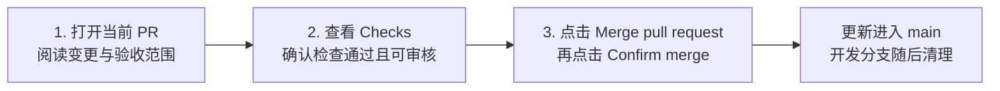

# GitHub 使用与交付

日常只需要打开 [待审核更新](https://github.com/3437564498/Auto-Reverse/pulls)，查看唯一活动 PR 和它的 **Checks**。这个入口固定，不需要记住每批 PR 编号。PR 是一批代码更新的审核页面，未合并前的修复继续更新同一个页面，不需要在多个开发分支之间选择。

仓库按 `main + 一个活动开发分支` 推进，合并后的开发分支自动清理。当前批次、远端 Checks 与可审核状态，以 [待审核更新](https://github.com/3437564498/Auto-Reverse/pulls) 的活动 PR 为准；未合并前的修复继续更新同一页面。开发分支出现、PR 建立、Checks 通过和完整 V1 验收是不同状态，不能互相替代。

| 页面上的名称 | 含义 |
|---|---|
| `main` | 已合并的代码；平时从这里查看、下载和使用项目 |
| `codex/...` | 当前唯一活动开发分支；具体批次以活动 PR 为准 |
| `Draft` | 这一批还在开发或验证，暂时不进入合并步骤 |
| `Ready for review` | 开发者已将这一批标记为可审核；仍需查看测试与验收范围 |
| `Checks` | GitHub 自动检查；通过表示这些检查成功，跳过的项目仍需另行验证 |
| `Merged` | 这一批更新已经进入 `main` |

## 查看并合并一批更新

1. 打开 PR，阅读说明中的“实现了什么、怎样验证、还有哪些未完成”。需要时查看 **Files changed**，无需逐个文件检查才能理解交付范围。
2. 等待开发者完成本批工作并取消 `Draft`。查看 **Checks**，确认没有失败；缺少真实环境或被跳过的验收会在说明中单独列出。
3. 决定接收这一批更新后，点击 **Merge pull request**，再点击 **Confirm merge**。如果页面提示冲突、检查失败或无法合并，留在同一 PR 反馈，由开发者继续处理。

合并只表示接收这一批代码。**它不代表完整 V1 已开发或验收完成**；完整范围和未通过的退出条件见 [实施记录](implementation-status.md)，未完工作集中在 [V1 总清单 #4](https://github.com/3437564498/Auto-Reverse/issues/4)。一个 PR 完成后，仍按清单继续推进剩余工作。

普通 CI 没有配置真实 NDK/Ghidra 时，相关测试会明确跳过。本批为相关源码、测试、脚本、工具锁、Schema 或静态 workflow 的 PR 变更增加自动的 **Pinned static acceptance matrix** 检查：它下载并校验固定 NDK/Ghidra/JDK，使用 CMake 3.31.6，运行完整 Python 测试和源码 ZIP 重建后新字节验证，无需用户手动触发。请分别查看普通检查和这个真实工具 job 的实际结果；新增检查配置不表示远端已经通过。

绿色 Checks 只代表页面列出的检查成功，不能代表真实 DSH 模型验收。当前最高交付为局部 A1，整库语义与完整 V1 仍未通过。

## 分支怎样保持简单

正常开发期间只保留 `main` 和一个活动开发分支。同一批修改继续向当前 PR 添加更新，合并以后再为下一批建立开发分支，避免为每次修复新建分支或 PR。

已合并的旧开发分支可以删除，已进入 `main` 的代码、提交历史和 PR 讨论仍然保留。删除分支不会撤回已经合并的更新。

自动清理流程已进入 `main`，PR #8–#11 合并后旧开发分支已实际清理。它仅清理本仓库已经合并的 `codex/` 分支，并使用审核时的提交进行条件删除。分支又增加提交时，删除会被拒绝；来自其他仓库、PR 仅关闭而未合并，或保护规则阻止删除时，也会保留。

清理完成后，在 [分支页面](https://github.com/3437564498/Auto-Reverse/branches) 通常只会看到 `main`；下一批开发开始时会再出现一个活动分支。自动清理受到仓库权限或保护规则阻止时，会在 Actions 中留下提示，由开发者处理。无需为了整理页面手工删除不确定的分支。

## 使用哪份代码

只想使用已接收的版本时，打开仓库首页的 `main`，点击 **Code → Download ZIP**，或克隆仓库后使用 `main`。正在验证的本批新命令可能只存在于开发分支；合并后才会出现在 `main` 的下载中。

当前批次的自动工程命令和报告含义见 [自动静态工程流水线](static-project-pipeline.md)。源码工程 ZIP 是工具产生的局部交付，GitHub 的 **Download ZIP** 是项目仓库源码，两者用途不同。运行结果内的 `state/` 为私有账本，不作为公开交付整体上传。
