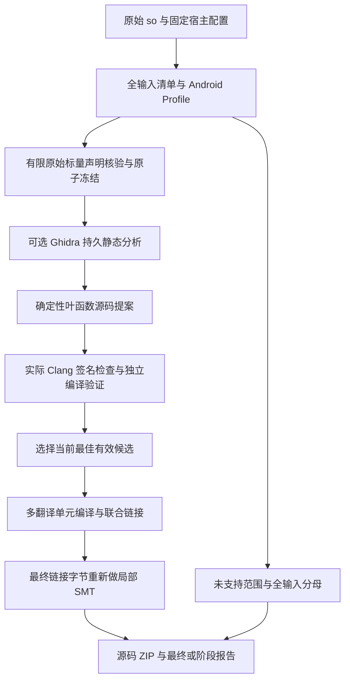

# 自动静态工程流水线

更新：2026-10-16（Asia/Singapore）。当前交付最高为真实编译的**局部 A1**，完整 V1 尚未验收。自动入口不调用模型，也不执行原库、候选库、模拟器或设备程序。

## 从 `.so` 开始

先安装项目依赖与固定静态工具链：

```bash
python -m venv .venv
.venv/bin/python -m pip install -r requirements.lock
.venv/bin/python -m pip install -e . --no-deps
.venv/bin/python scripts/install_static_toolchains.py
export JAVA_HOME="$PWD/work/tools/jdk-21.0.8+9"
```

使用新的或空的输出目录：

```bash
.venv/bin/arm64-recover recover-project \
  --binary ./libtarget.so \
  --output work/recovered-project \
  --ndk-root work/tools/android-ndk-r27c \
  --api-level 21 \
  --ghidra-home work/tools/ghidra_11.3.2_PUBLIC
```

`--ghidra-home` 可省略；指定时通过持久分析活动运行固定 Ghidra，并保存静态 Raw P-code 证据。`JAVA_HOME` 指向固定 JDK。Raw P-code 导出本身不构成机器语义证明，最终验证仍读取原库和最终产物的实际 ARM64 字节。

输入上限为 256 MiB，工具链固定 NDK r27c、ARM64、C++17。自动入口默认 API21，可通过 `--api-level`（别名 `--api`）选择受支持的 API；原库 Android Profile 的要求另行报告，不把编译 API 当作原库兼容性证明。该入口采用受控构建配置，不接收候选自带的构建脚本或编译参数。

## 实际做了什么



每次自动生成最多处理按名称排序的 64 个安全命名的普通动态导出函数。原始 unsigned32/64 DWARF 声明可核验后冻结为有界 bundle；缺失或不支持的声明不猜测为已知 ABI。源码生成只覆盖已支持的整数叶函数，拒绝未初始化寄存器读取、不支持的原始指令和不满足模型的范围。

持久阶段顺序为 PLAN → TYPES → ANALYSIS（可选）→ RECOVER → INTEGRATE → FINAL。先冻结有限类型契约，再执行 Ghidra 分析，分析与后续候选绑定同一当前 revision。

生成源码以普通工作包、真实租约、Proposal、CAS 与回执提交。这里的 provider 为 `deterministic-static`，没有 DSH 模型会话。回执只表示已记录，可信宿主随后独立检查实际候选签名、源码编译、结构和机器语义；不合格候选不会靠自报结果进入有效选择。

集成服务物化当前所选源码，按独立翻译单元编译和链接，并生成受控公共声明。它不会用原机器码、空实现或旧证明补齐缺失范围。最终 ELF 必须重新做局部证明；各个候选单独通过不能替代联合链接后的验证。

全输入动态导出、导入、已发现函数、可执行字节、调用线索、全局量和生命周期根始终保留。未选中、超出 64 个、无法恢复或未发现完整范围的义务继续体现在缺口和覆盖率中，不能以生成成功的子集作为新分母。

## 查看输出

| 路径 | 内容与用途 |
|---|---|
| `status.json` | 当前流水线状态、质量、模型调用数、执行策略、产物引用及生成缺口 |
| `report.json` | 已发布的版本化最终/阶段报告；同时查看当前有效性与缺口 |
| `candidate.so` | 成功集成后实际编译的局部候选库；仅供静态检查，不加载或执行 |
| `project.zip` | 成功集成后的源码、受控头文件、CMake 和公开构建/验证报告 |
| `state/` | 私有 SQLite/CAS、活动和进程所有权账本；用于接续，不整体分享 |
| `.recovery-input.json` | 同一输出目录对应的原输入和宿主配置绑定 |

没有有效编译/集成时，候选库与 ZIP 可以缺省，报告保留 A0 和原因。不要仅根据文件存在或命令返回判断验收通过；以 `status.json`、`get-final-delivery` 的 `current_valid`、明确作用域、质量和缺口为准。输出目录会保留私有状态，交付时只选需要的公开产物。

接续时发现证据失效，`status.json` 的 `current_valid` 会降为 false，当前导出路径清空。程序先核对原导出的内容指纹，再将自己的旧 ZIP、候选库和报告移为 `.historical-<sha256>-<原文件名>`，并列入 `historical_exports`；这些文件仅供历史审计。用户改写过的文件会保留，命令报错，不会替用户移动或覆盖它。

`project.zip` 不包含原库、目标 `.so`、对象文件、数据库、socket 或运行凭据。归档中的报告描述原来那次实际构建，不自动授权另一次构建的机器码。

## 重建源码工程

独立重建验收使用固定 CMake 3.31.6，可先安装：

```bash
.venv/bin/python -m pip install cmake==3.31.6
export PATH="$PWD/.venv/bin:$PATH"
```

解包后按归档自带 README 的固定 API、STL 和 NDK 配置构建。例如默认 API21、shared libc++ 的工程：

```bash
.venv/bin/python -m zipfile -e work/recovered-project/project.zip work/project-unpacked
cmake -S work/project-unpacked -B work/project-rebuilt \
  -DCMAKE_TOOLCHAIN_FILE="$PWD/work/tools/android-ndk-r27c/build/cmake/android.toolchain.cmake" \
  -DANDROID_ABI=arm64-v8a \
  -DANDROID_PLATFORM=android-21 \
  -DANDROID_STL=c++_shared
cmake --build work/project-rebuilt
```

以上只编译和链接，不执行构建出的库。重建产物若用于后续结论，须对该文件重新做静态验证并保存新的字节/工具/构建绑定；不能沿用归档里旧产物的 EXACT 结论。

可运行包含真实原库生成、自动流水线、解包、CMake 重建与新产物静态证明的宿主样例：

```bash
.venv/bin/python scripts/run_project_pipeline_sample.py \
  --ndk-root work/tools/android-ndk-r27c \
  --output work/project-pipeline-sample
```

相关源码、测试、脚本、工具锁、Schema 或静态 workflow 的 PR 变更会自动触发 [固定工具静态验收](../.github/workflows/static-acceptance.yml)。它下载并校验固定 NDK/Ghidra/JDK，安装 CMake 3.31.6，执行完整 Python 测试、静态矩阵和上面的源码 ZIP 重建/新产物证明样例；无需手动 dispatch。普通 CI 未安装真实工具时仍明确 skip，应单独查看该静态 job 的实际结果，不把 workflow 配置本身记作验收通过。

## 检查原始结构布局证据

后续类型工作可先读取原库自身的有限 DWARF 结构声明：

```bash
.venv/bin/arm64-recover inspect-dwarf-layouts \
  --binary ./libtarget.so --max-types 128 > work/original-layouts.json
```

输入上限为 64 MiB，每次最多检查 128 个聚合声明（包含不支持的声明）。支持的普通结构体列出 unsigned32/64 字段和嵌套结构的声明字节范围，以及原输入、调试区段、CU/DIE 和解析器指纹。无调试信息、类、union、继承、位域、表达式位置、冲突或超出预算时保留 UNKNOWN。

该入口输出原始声明的 A0 辅助证据，供后续类型约束工作使用；调试信息真实性和原调用 ABI 仍未证明。`recover-project` 当前冻结的类型契约仍为有限 unsigned 标量，完整对象布局与类型系统继续列入 V1 缺口。

## 核对候选结构体声明

已有受支持的原始布局证据时，可用固定 NDK Clang 核对实际候选源码：

```bash
.venv/bin/arm64-recover inspect-candidate-layouts \
  --original ./libtarget.so --source ./candidate.cpp \
  --type example::Header --type example::Payload \
  --ndk-root work/tools/android-ndk-r27c --api-level 24 \
  --output work/candidate-layout-check > work/candidate-layout-report.json
```

每次指定 1–16 个安全限定类型名，原库上限 64 MiB，候选源码上限 1 MiB，输出目录须为新的或空的目录。原始布局由宿主直接重读；嵌套结构按原始 DWARF 的物理 DIE 引用扩展检查。候选的实际 Clang AST 与宿主生成的编译期断言分别核对普通结构体、唯一字段集合、大小、字段偏移、unsigned32/64 类型和嵌套类型身份；只执行编译器的语法检查，不生成或加载候选库。

`status=PASS` 仅表示有限范围的声明存储约束匹配，报告等级仍为 **A0**。原始 DWARF 没有声明对齐时，这项仍为未知；调试信息真实性、机器访存语义和原调用 ABI 均未证明。缺失或不支持的原始证据不能由候选声明补齐；继承、方法、位域、模板及超出预算的形状保留 FAIL/UNKNOWN。工具内容变化或清理未确认时也不能通过。此命令不会创建 Job、冻结聚合类型契约或提升当前候选质量。

可运行包含真实原库编译、普通/嵌套/packed/显式对齐匹配与错误字段类型、错误偏移和缺失原始证据反例的宿主样例：

```bash
.venv/bin/python scripts/run_candidate_layout_sample.py \
  --ndk-root work/tools/android-ndk-r27c --output work/candidate-layout-sample
```

## 冻结原始布局声明

布局目录为每个原始物理类型提供输入绑定的 `dwarf-layout:` 身份，避免把同名、不同输入或不同 CU 的类型混为一个：

```bash
.venv/bin/arm64-recover inspect-layout-catalog \
  --binary ./libtarget.so > work/layout-catalog.json
.venv/bin/arm64-recover --state-dir work/job-state get-layout-contracts JOB_ID
.venv/bin/arm64-recover --state-dir work/job-state list-layout-contracts JOB_ID --limit 20
```

可信宿主将 1–16 个根类型放入 `type_abi` 工包的专用 `scope.type_ids`；原始目录经冻结清单供工作者读取。实际 Proposal/回执和工作者清理确认后，宿主 `freeze-layout-bundle` 接收其 `--execution-key`、`--artifact-ref` 与 `--expected-revision`。提交内容只有原始类型身份与声明绑定，不接受自报质量或匹配结论。任一成员未知或冲突时整包不发布；成功时把宿主独立核验的根与嵌套闭包、current/history、事件和 revision 一次提交。旧任务与工具被版本隔离，资源仍由实际清理决定何时释放。

`get-layout-contracts` 每次核对原始字节、解析器、实际发布回执/Proposal、原授权作用域、证据清单及 CAS；失效项明确列出。历史重放不再次推进版本，也不让历史记录获得当前权威。两项公开 MCP 读取不会创建可选表、冻结声明或启动编译器。空 `type_ids` 保留旧版任务的原始规范表示，既有幂等键和回执哈希不改写。

这项事务只冻结原始普通结构存储声明，最高 A0。`recover-project` 的自动 TYPES 阶段仍只处理有限标量；宿主另行指定的候选实际 TU、跨文件工程、ZIP 与 FINAL 布局依赖见[实际编译的布局依赖](layout-dependencies.md)。聚合传参/返回和完整调用 ABI 继续 UNKNOWN。

可复现真实原库、离线租约交付、两个根与一个嵌套类型、一次版本推进和无副作用历史重放：

```bash
.venv/bin/python scripts/run_layout_contract_sample.py \
  --ndk-root work/tools/android-ndk-r27c --output work/layout-contract-sample
```

该样例只编译用于原始 DWARF 的受控 fixture，事务本身不启动编译器，模型调用数为 0；`state/` 为私有账本，公开证据只取 `layout-contract-sample.json`。

## 接续与中断

对于相同输入、工具和配置，重复执行原 `recover-project` 命令即可按账本接续。每 Job 使用排他控制器锁；回执、标量 bundle、验证和集成使用幂等身份，已提交结果不重复生成。另一控制器正在推进同一 Job 时返回 `PIPELINE_BUSY`。

已有非空目录必须属于完全相同的输入和配置；不接受符号链接目录，也不允许把输入放在输出目录内。输入、工具或实现指纹变化时不会静默混用旧成果。保持原环境以续跑，或使用新的输出目录重新分析。

| `pipeline_state` | 含义 |
|---|---|
| `DONE` | 已形成当前有效的 FINAL 报告；质量仍可能是 A0 或局部 A1 |
| `STEP_LIMIT` | 本次有限步数已用完，可继续推进同一账本 |
| `NEEDS_RECONCILIATION` | 存在运行中/隔离活动、未确认清理，或当前交付尚不满足收尾条件 |
| `CANCELED` | Job 已取消或不能继续推进，不再自动派发恢复工作 |

`recover-project` 将私有状态放在自身输出目录的 `state/`，后续查询须显式使用这个目录；全局 `--state-dir` 放在子命令前。先从 `status.json` 获取 `job_id`：

```bash
.venv/bin/arm64-recover --state-dir work/recovered-project/state get-job JOB_ID
.venv/bin/arm64-recover --state-dir work/recovered-project/state get-final-delivery JOB_ID
.venv/bin/arm64-recover --state-dir work/recovered-project/state inspect-host --job-id JOB_ID
```

`inspect-host` 只读账本，返回活动种类、run、owner hash、worker、启动意图和进程绑定，不声称进程已退出。可信宿主确认旧 owner 已失联后，可使用返回的精确 guard 隔离；示例中的占位符都应取自同一次当前查询：

```bash
.venv/bin/arm64-recover --state-dir work/recovered-project/state reconcile-host \
  validation ACTIVITY_ID \
  --expected-run-number RUN_NUMBER \
  --expected-owner-hash OWNER_HASH \
  --expected-worker-id WORKER_ID \
  --reason "host controller interrupted"
.venv/bin/arm64-recover --state-dir work/recovered-project/state confirm-host-cleanup \
  validation ACTIVITY_ID \
  --expected-run-number RUN_NUMBER \
  --expected-owner-hash OWNER_HASH \
  --expected-worker-id WORKER_ID
```

活动种类可为 `validation`、`integration` 或 `analysis`。隔离只阻断旧 owner 发布，不释放容量、不终止进程、不自动重放。清理确认独立检查已登记的整个进程组及 boot ID/PID 起始身份；父进程退出或租约过期均不足以确认清理。缺少登记、仍有待定启动、身份不符或观察不完整时，活动继续保留占用。对账本做人工强制修改不能构成清理证据。

## 宿主分步入口

已有 Job 可以单独排队持久 Ghidra 分析。排队与 worker 使用相同固定工具配置，队列 idempotency key 由宿主指定：

```bash
.venv/bin/arm64-recover --state-dir work/job-state queue-analysis JOB_ID \
  --idempotency-key original-ghidra-v1 \
  --ghidra-home work/tools/ghidra_11.3.2_PUBLIC \
  --java-home work/tools/jdk-21.0.8+9
.venv/bin/arm64-recover --state-dir work/job-state analysis-worker --once \
  --activity-id ANALYSIS_ACTIVITY_ID \
  --ghidra-home work/tools/ghidra_11.3.2_PUBLIC \
  --java-home work/tools/jdk-21.0.8+9
.venv/bin/arm64-recover --state-dir work/job-state list-analyses JOB_ID
.venv/bin/arm64-recover --state-dir work/job-state get-analysis JOB_ID ANALYSIS_ACTIVITY_ID
.venv/bin/arm64-recover --state-dir work/job-state read-analysis-report JOB_ID ANALYSIS_ACTIVITY_ID
```

已有当前有效选择时，工程集成和报告也可分步推进。排队与 worker 的 NDK/API/runtime/optimization/SONAME/超时配置须一致；以下示例使用默认构建配置：

```bash
.venv/bin/arm64-recover --state-dir work/job-state queue-integration JOB_ID \
  --idempotency-key selected-project-v1 --ndk-root work/tools/android-ndk-r27c
.venv/bin/arm64-recover --state-dir work/job-state integration-worker --once \
  --ndk-root work/tools/android-ndk-r27c
.venv/bin/arm64-recover --state-dir work/job-state get-integration JOB_ID INTEGRATION_ACTIVITY_ID
.venv/bin/arm64-recover --state-dir work/job-state publish-final-report JOB_ID \
  --expected-revision CURRENT_REVISION --idempotency-key delivery-v1 \
  --integration-activity-id INTEGRATION_ACTIVITY_ID
```

只读历史入口包括 `list-integrations`、`read-integration-report`、`list-final-deliveries` 和 `read-final-report`；分页命令使用 `--cursor/--limit`，报告读取使用 `--offset/--limit`。公共 MCP 提供对应只读视图；排队、worker、契约冻结和宿主对账属于可信宿主管理操作。

## 当前结论与历史结论

最终报告在同一冻结范围内记录原始清单、当前选择、工程、覆盖、质量、资源清理和缺口。只有 DAG 与工具活动均满足终态及清理条件，才发布 FINAL 并允许 Job COMPLETED；否则为 INTERIM。

读取时重新核验当前快照、契约、源码、工具、实现和证据绑定。失效报告仍可按历史读取，但 `current_valid=false`，当前质量为 UNKNOWN，历史质量另行展示。Job 已 COMPLETED 不免除此检查。

局部 A1 表示真实源码已经编译，局部 EXACT 表示特定函数在明确模型下通过；全库构建、原调用 ABI、全局/TLS/初始化语义、JNI 和入口闭包仍有未完成义务。始终 `whole_program_equivalence=false`，不开放 A2/A3 或发布选择。完整差距见 [实施记录](implementation-status.md)，真实 DSH 模型环境保持未验收。
